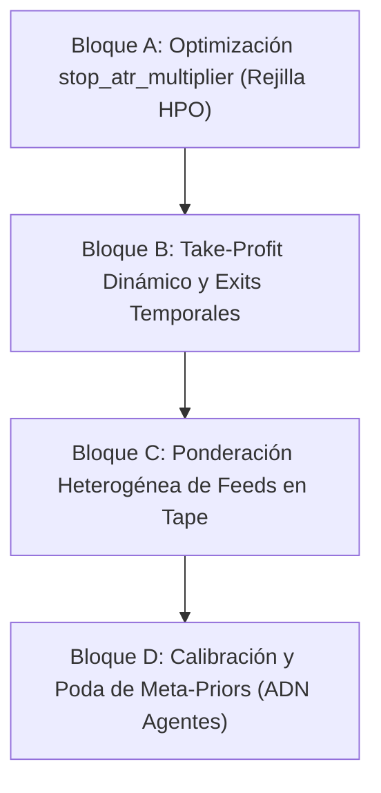

# Plan Exhaustivo de Optimización y Evolución del Enjambre (Swarm Consensus)

Este documento técnico detalla la arquitectura, el diseño matemático y el plan de implementación paso a paso para abordar las cuatro vías de mejora cuantitativa (**A**, **B**, **C** y **D**) de la estrategia `SwarmConsensusStrategy` en el repositorio ATSNT.

El objetivo es transformar el prototipo inicial del TFM en un motor cuantitativo robusto, con ventaja estadística (*alpha*) fuera de muestra, preservando al 100% las directrices del proyecto:
- **Aritmética Financiera**: 100% `rust_decimal::Decimal`, cero coma flotante (`f32`/`f64`).
- **Fiabilidad y Manejo de Errores**: Cero `unwrap()` / `expect()` en código de dominio y producción.
- **Rendimiento**: Preservar la arquitectura de cinta en dos etapas (`Tape<F>`) para que el HPO evalúe miles de candidatos en segundos.
- **Invarianza de Regresión**: Las snapshots golden de CUSUM y OFI deben mantenerse idénticas byte a byte.
- **Rigor Estadístico Anti-Sobreajuste**: Validación Walk-Forward (WFO), Embargo temporal (AFML Ch. 7) y Deflated Sharpe Ratio (DSR).

---

## Índice de Contenidos

1. [Diagnóstico de la Línea Base (Resultados Fase 9)](#1-diagnóstico-de-la-línea-base-resultados-fase-9)
2. [Bloque A: Optimización del Multiplicador de Stop Loss (`stop_atr_multiplier`)](#2-bloque-a-optimización-del-multiplicador-de-stop-loss-stop_atr_multiplier)
3. [Bloque B: Take-Profit Dinámico y Salida Temporal / Trailing Stop](#3-bloque-b-take-profit-dinámico-y-salida-temporal--trailing-stop)
4. [Bloque C: Ponderación Heterogénea y Selección de Feeds (Feed Weighting & Pruning)](#4-bloque-c-ponderación-heterogénea-y-selección-de-feeds-feed-weighting--pruning)
5. [Bloque D: Optimización de los Meta-Priors del Enjambre (ADN de los Agentes)](#5-bloque-d-optimización-de-los-meta-priors-del-enjambre-adn-de-los-agentes)
6. [Estrategia de Ejecución Iterativa (Hoja de Ruta)](#6-estrategia-de-ejecución-iterativa-hoja-de-ruta)
7. [Índice de Referencias al Código](#7-índice-de-referencias-al-código)

---

## 1. Diagnóstico de la Línea Base (Resultados Fase 9)

En la prueba de validación sobre datos reales de Binance Futures para BTCUSDT (2026-04 a 2026-09, ~200 millones de trades) se observaron métricas diagnósticas clave:

1. **Tasa de ruido elevada (67.12%)**:
   - Archivo de auditoría: [`SwarmAudit::noise_rate`](file:///home/f92esmup/Projects/ATSNT/crates/strategies/src/swarm_consensus/audit.rs#L70).
   - Dos de cada tres muestras generadas tienen microconjuntos de velas vacíos o no cumplen filtros, forzando a los agentes a votar `Wait (0,0)`.
2. **Dispersión y asimetría de reglas**:
   - Reglas como `E2` (ruptura con tendencia) y `X3` (salida por RSI) disparan más de 50.000 y 450.000 veces respectivamente, mientras que `E4` y `X4` apenas dispararon decenas de veces ([`SwarmAudit::rule_firings`](file:///home/f92esmup/Projects/ATSNT/crates/strategies/src/swarm_consensus/audit.rs#L74)).
3. **Fuga de beneficios por falta de toma de beneficios (Take-Profit)**:
   - En el backtest a resolución de trade ([`crates/backtest/src/engine.rs`](file:///home/f92esmup/Projects/ATSNT/crates/backtest/src/engine.rs)), operaciones ganadoras se mantuvieron abiertas durante más de **40.000 a 140.000 segundos** (11 a 38 horas) esperando que el consenso cayera a 0 o hiciera un flip. Al no haber salida por objetivo de beneficio ni por decaimiento temporal, el mercado revirtió y terminaron saliendo por stop loss.
4. **Stop loss estático desconectado del HPO**:
   - El multiplicador de stop está congelado en `3.0` ATR en [`SwarmPolicySpace`](file:///home/f92esmup/Projects/ATSNT/crates/strategies/src/swarm_consensus/policy.rs#L319), impidiendo calibrar el ratio riesgo/beneficio.

---

## 2. Bloque A: Optimización del Multiplicador de Stop Loss (`stop_atr_multiplier`) [COMPLETADO]

### 2.1 Justificación Teórica y Cuantitativa
El stop loss del enjambre se calcula como:
$$\text{distancia\_stop} = \text{stop\_atr\_multiplier} \times \text{ATR}_{1\text{h}}$$
A su vez, el tamaño de la posición depende directamente de esta distancia a través de [`domain::size_target`](file:///home/f92esmup/Projects/ATSNT/crates/domain/src/risk.rs#L140):
$$\text{Cantidad} = \frac{\text{Equity} \times \text{Riesgo}}{\text{distancia\_stop}}$$
Al mantener `stop_atr_multiplier = 3.0` fijo, el HPO está atado de manos: no puede probar stops más ceñidos (que aumentan el tamaño de la posición para capturar movimientos explosivos rápidos) ni stops más holgados (para evitar el ruido en activos de alta volatilidad).

### 2.2 Estado Actual en el Código
- **Definición**: [`PolicyConfig.stop_atr_multiplier`](file:///home/f92esmup/Projects/ATSNT/crates/strategies/src/swarm_consensus/policy.rs#L61) existe en el struct, pero su espacio de búsqueda en [`SwarmPolicySpace`](file:///home/f92esmup/Projects/ATSNT/crates/strategies/src/swarm_consensus/policy.rs#L319) es un vector de un único valor:
  ```rust
  stop_atr_multipliers: vec![dec!(3.0)],
  ```
- **Perturbación de Vecinos**: En [`SwarmPolicySpace::perturb_neighbors`](file:///home/f92esmup/Projects/ATSNT/crates/strategies/src/swarm_consensus/policy.rs#L377), no se perturba la sexta dimensión (`stop_atr_multiplier`), por lo que la estabilidad de plateau no evalúa la sensibilidad del stop.

### 2.3 Plan de Implementación Paso a Paso

1. **Paso A.1: Expandir el Grid de Búsqueda**:
   - Modificar [`SwarmPolicySpace::default()`](file:///home/f92esmup/Projects/ATSNT/crates/strategies/src/swarm_consensus/policy.rs#L304) para incluir una rejilla representativa de múltiplos de ATR:
     ```rust
     stop_atr_multipliers: vec![dec!(1.5), dec!(2.0), dec!(2.5), dec!(3.0), dec!(4.0)],
     ```
2. **Paso A.2: Implementar la Perturbación en 6 Dimensiones**:
   - En [`SwarmPolicySpace::perturb_neighbors`](file:///home/f92esmup/Projects/ATSNT/crates/strategies/src/swarm_consensus/policy.rs#L377), añadir la perturbación adyacente para `stop_atr_multiplier`:
     ```rust
     push(
         &mut neighbors,
         adjacent_grid_values(&self.stop_atr_multipliers, base.stop_atr_multiplier),
         &|stop_atr_multiplier| PolicyConfig {
             stop_atr_multiplier,
             ..base.clone()
         },
     );
     ```
3. **Paso A.3: Control de Explosión Combinatoria**:
   - Pasar de 1 a 5 valores multiplica el número de combinaciones por 5 ($1.470 \times 5 = 7.350$ candidatos).
   - Gracias a la cinta en dos etapas (`Tape<F>`), evaluar 7.350 candidatos en Rayon tardará ~75 segundos en CPU. Sin embargo, para mantener el tiempo bajo 30 segundos, se puede acotar la búsqueda mediante submuestreo pseudoaleatorio determinista (`max_candidates` en [`run_hpo`](file:///home/f92esmup/Projects/ATSNT/crates/backtest/src/bin/run_hpo.rs)) o adelgazar ligeramente la rejilla de `hysteresis`.
4. **Paso A.4: Pruebas Unitarias y de Regresión**:
   - Actualizar [`policy::tests::candidates_are_on_the_grid_valid_and_deterministic`](file:///home/f92esmup/Projects/ATSNT/crates/strategies/src/swarm_consensus/policy.rs#L600).
   - Verificar que `perturb_neighbors` genera hasta 12 vecinos válidos (2 por cada una de las 6 dimensiones).

---

## 3. Bloque B: Take-Profit Dinámico y Salida Temporal / Trailing Stop [COMPLETADO]

### 3.1 Justificación Teórica y Cuantitativa
El TFM original en MetaTrader 5 cerraba órdenes por dos vías: o tocaba el stop loss de emergencia, o esperaba a que el bloque de reglas CLIPS arrojara un voto de cierre o contradicción.
En criptoactivos de alta volatilidad como Bitcoin, el precio suele experimentar impulsos violentos seguidos de retrocesos rápidos (*mean reversion*). Si el enjambre no recoge beneficios cuando el trade se mueve a favor $2\times$ o $3\times$ el ATR, el consenso se degrada lentamente mientras el precio cae, convirtiendo un trade ganador en perdedor.

### 3.2 Estado Actual en el Código
- **Puertos y Adaptadores (Fase 8)**:
  - En [`crates/ports/src/exits.rs`](file:///home/f92esmup/Projects/ATSNT/crates/ports/src/exits.rs#L22), `ExitGateway::place_exits` ya fue generalizado para aceptar `take_profit: Option<Decimal>`.
  - Tanto [`SimulatedVenue`](file:///home/f92esmup/Projects/ATSNT/crates/adapters/src/simulated_venue.rs#L440) como [`BinanceGateway`](file:///home/f92esmup/Projects/ATSNT/crates/adapters/src/binance_gateway/exits.rs#L360) están listos para armar órdenes `TAKE_PROFIT_MARKET` condicionales si se les pasa `Some(tp)`.
- **Dominio**:
  - [`domain::TargetPosition`](file:///home/f92esmup/Projects/ATSNT/crates/domain/src/decision.rs#L25) solo almacena `stop_distance: Decimal`. Carece de campo para take profit o límite temporal.
  - [`domain::ProtectiveExits::for_target`](file:///home/f92esmup/Projects/ATSNT/crates/domain/src/decision.rs#L125) coloca `take_profit: None` y `max_bars: None`.

### 3.3 Plan de Implementación Paso a Paso

1. **Paso B.1: Extender `TargetPosition` y `PolicyConfig`**:
   - En [`crates/domain/src/decision.rs`](file:///home/f92esmup/Projects/ATSNT/crates/domain/src/decision.rs#L25), añadir:
     ```rust
     pub struct TargetPosition {
         timestamp: i64,
         level: i8,
         risk_fraction: Decimal,
         stop_distance: Decimal,
         take_profit_distance: Option<Decimal>, // <- Nuevo
         max_holding_ms: Option<i64>,          // <- Nuevo
     }
     ```
   - En [`PolicyConfig`](file:///home/f92esmup/Projects/ATSNT/crates/strategies/src/swarm_consensus/policy.rs#L49), añadir:
     - `take_profit_atr_multiplier: Option<Decimal>`: Múltiplo de ATR para colocar orden de toma de beneficios (ej. $1.5\times$ o $2.0\times$ la distancia del stop).
     - `decay_horizon_seconds: Option<u64>`: Tiempo máximo de estancamiento de nivel antes de forzar reducción escalonada.
2. **Paso B.2: Integración en `ProtectiveExits::for_target`**:
   - Actualizar el constructor en [`crates/domain/src/decision.rs`](file:///home/f92esmup/Projects/ATSNT/crates/domain/src/decision.rs#L125) para calcular el precio objetivo:
     $$\text{Precio TP (Long)} = \text{Fill} + \text{take\_profit\_distance}$$
     $$\text{Precio TP (Short)} = \text{Fill} - \text{take\_profit\_distance}$$
   - Pasar `take_profit: Some(tp_price)` a [`ProtectiveExits`](file:///home/f92esmup/Projects/ATSNT/crates/domain/src/decision.rs#L110).
3. **Paso B.3: Ejecución en `ExecutionCore` y `TradingSession`**:
   - En [`crates/backtest/src/execution_core.rs`](file:///home/f92esmup/Projects/ATSNT/crates/backtest/src/execution_core.rs#L280), `barrier_exit` ya evalúa `exits.take_profit`. Si el precio toca el TP, la posición se cierra registrando la razón `TakeProfit`.
   - Si se alcanza el TP, la máquina de consenso debe recibir una notificación de re-armado (`rearm`) análoga a la del stop out para evitar reabrir inmediatamente en el mismo nivel.
4. **Paso B.4: Integración en el Espacio de HPO**:
   - Añadir `take_profit_atr_multipliers` a [`SwarmPolicySpace`](file:///home/f92esmup/Projects/ATSNT/crates/strategies/src/swarm_consensus/policy.rs#L285) (ej. `[None, Some(dec!(1.5)), Some(dec!(2.5)), Some(dec!(4.0))]`).

---

## 4. Bloque C: Ponderación Heterogénea y Selección de Feeds (Feed Weighting & Pruning) [COMPLETADO]

> [!NOTE]
> **Estado de Implementación:** Bloque C implementado y verificado.
> - `FeedVote` y desglose de votos por feed en [`ConsensusSample`](file:///home/f92esmup/Projects/ATSNT/crates/strategies/src/swarm_consensus/sample.rs).
> - Agregación single-pass en [`SwarmEnsemble::sample`](file:///home/f92esmup/Projects/ATSNT/crates/strategies/src/swarm_consensus/ensemble.rs) (~6x más eficiente).
> - Ponderación heterogénea y poda de feeds con `FeedWeights` y perfiles curados en [`PolicyConfig`](file:///home/f92esmup/Projects/ATSNT/crates/strategies/src/swarm_consensus/policy.rs).
> - Exploración de perfiles de peso en el espacio HPO [`SwarmPolicySpace`](file:///home/f92esmup/Projects/ATSNT/crates/strategies/src/swarm_consensus/policy.rs).
> - 100% test pass workspace, non-regression en snapshots golden CUSUM/OFI y runners del enjambre.

### 4.1 Justificación Teórica y Cuantitativa
Actualmente, los 16 feeds se tratan con **pesos idénticos**:
- Cada feed tiene exactamente 6 agentes ($16 \times 6 = 96$).
- El voto de un agente en el feed de 5 minutos (altamente ruidoso) cuenta exactamente igual (1/96) que el voto de un agente en el feed diario o en un feed de rango.
- En la auditoría vimos que la tasa de ruido fue del **67.12%**. Gran parte de ese ruido proviene de feeds de alta frecuencia que sufren continuos falsos quiebres.

### 4.2 Estado Actual en el Código
- En [`crates/strategies/src/swarm_consensus/sample.rs`](file:///home/f92esmup/Projects/ATSNT/crates/strategies/src/swarm_consensus/sample.rs#L46):
  ```rust
  fn net(up: u32, down: u32, agents: u32) -> Decimal {
      (Decimal::from(up) - Decimal::from(down)) / Decimal::from(agents)
  }
  ```
  El voto neto es un promedio aritmético plano sin ponderaciones.
- [`ConsensusSample`](file:///home/f92esmup/Projects/ATSNT/crates/strategies/src/swarm_consensus/sample.rs#L11) almacena únicamente agregados globales (`long_up`, `long_down`, etc.), perdiendo la información de qué feed emitió cada voto.

### 4.3 Plan de Implementación Paso a Paso

Existen dos arquitecturas posibles. Seleccionamos la **Opción 1** por su total compatibilidad con la cinta en dos etapas del HPO:

#### Opción 1: Muestras de Consenso con Desglose por Categoría/Feed (Recomendada)
1. **Paso C.1: Desglosar Votos en `ConsensusSample`**:
   - En [`crates/strategies/src/swarm_consensus/sample.rs`](file:///home/f92esmup/Projects/ATSNT/crates/strategies/src/swarm_consensus/sample.rs#L11), sustituir o complementar los escalares globales por un array de votos por feed:
     ```rust
     pub struct FeedVoteCount {
         pub up: u8,
         pub down: u8,
     }

     pub struct ConsensusSample {
         pub timestamp: i64,
         pub feed_votes_long: [FeedVoteCount; FEED_COUNT],  // 16 feeds
         pub feed_votes_short: [FeedVoteCount; FEED_COUNT], // 16 feeds
         pub atr_stop_reference: Decimal,
         pub price: Decimal,
     }
     ```
   - El struct ocupa solo ~70 bytes por muestra, perfectamente manejable en RAM para millones de eventos.
2. **Paso C.2: Ponderación en `PolicyConfig`**:
   - En [`PolicyConfig`](file:///home/f92esmup/Projects/ATSNT/crates/strategies/src/swarm_consensus/policy.rs#L49), definir un vector de pesos normalizado $\mathbf{w} \in \text{Decimal}^{16}$ con $\sum w_i = 1$.
   - Para no añadir 16 parámetros al HPO (lo cual generaría sobreajuste), se agrupan en **4 pesos macro por tipo de feed**:
     $$\mathbf{w}_{\text{tipo}} = [w_{\text{time}}, \; w_{\text{tick}}, \; w_{\text{volume}}, \; w_{\text{range}}]$$
     con $w_{\text{time}} + w_{\text{tick}} + w_{\text{volume}} + w_{\text{range}} = 1$.
3. **Paso C.3: Cálculo del Voto Neto Ponderado**:
   - En [`ConsensusSample::long_net`](file:///home/f92esmup/Projects/ATSNT/crates/strategies/src/swarm_consensus/sample.rs#L36):
     $$\text{Voto Neto Long} = \sum_{f=0}^{15} w_f \cdot \left(\frac{\text{up}_f - \text{down}_f}{\text{agentes\_por\_feed}}\right)$$
4. **Paso C.4: Poda de Feeds (Feed Pruning)**:
   - Capacidad de asignar peso $0$ a feeds que demuestren correlación nula o negativa con el forward return (ej. descartar feeds de tiempo ultra-cortos y centrarse en volumen y rango).
   - **Ventaja de Rendimiento**: Al estar los votos desglosados en el tape, probar distintas combinaciones de pesos en el HPO se ejecuta en la Fase 2 (cero recálculo de indicadores, evaluación en milisegundos).

---

## 5. Bloque D: Optimización de los Meta-Priors del Enjambre (ADN de los Agentes)

### 5.1 Justificación Teórica y Cuantitativa
El enjambre genera a sus 96 agentes a partir de la tabla fija [`GENE_PRIORS`](file:///home/f92esmup/Projects/ATSNT/crates/strategies/src/swarm_consensus/genome.rs#L64-L118).
Estos valores ($\mu$ y $\sigma$) fueron heredados del TFM original (diseñado para mercados tradicionales/Forex). En futuros de criptomonedas:
- El umbral medio de sobrecompra en RSI de 70 y sobreventa de 30 puede ser demasiado restrictivo o generar señales tardías en tendencias parabólicas.
- La mecha de pin bar con media 2.8x del cuerpo (`pinbar_long_ratio`) puede ser excesivamente estricta en velas de ticks rápidos, donde las pin bars válidas tienen mechas de 2.0x.

### 5.2 El Desafío Matemático: Evitar las 1.056 Dimensiones
Optimizar $96 \times 11 = 1.056$ genes de forma individual:
1. Destruiría la generalización estadística (sobreajuste asegurado).
2. Rompería la cinta en dos etapas del HPO (requeriría recalcular los 96 agentes sobre 200M de trades para cada candidato, tardando horas o días).

### 5.3 Solución: Calibración y Optimización de Meta-Priors ($\boldsymbol{\mu}$)

En lugar de optimizar a cada agente, optimizamos **el centro de gravedad de la población** (las medias $\mu$ de los 11 genes).

1. **Paso D.1: Estructurar `SwarmPriorsConfig`**:
   - En [`crates/strategies/src/swarm_consensus/genome.rs`](file:///home/f92esmup/Projects/ATSNT/crates/strategies/src/swarm_consensus/genome.rs), hacer que [`sample_swarm`](file:///home/f92esmup/Projects/ATSNT/crates/strategies/src/swarm_consensus/genome.rs#L230) acepte un struct configurable de priors en lugar de leer exclusivamente la constante:
     ```rust
     #[derive(Debug, Clone, PartialEq, Eq, Serialize, Deserialize)]
     pub struct SwarmPriorsConfig {
         pub priors: [GenePrior; GENE_COUNT],
     }
     ```
   - Integrar `SwarmPriorsConfig` dentro de [`SwarmConfig`](file:///home/f92esmup/Projects/ATSNT/crates/strategies/src/swarm_consensus/ensemble.rs#L39) (el `SharedConfig` que viaja en `swarm_shared.json`).
2. **Paso D.2: Calibración Previa de Priors en `calibrate_feeds`**:
   - Extender el binario [`calibrate_feeds`](file:///home/f92esmup/Projects/ATSNT/crates/backtest/src/bin/calibrate_feeds.rs) para que no solo calibre los umbrales de barras, sino que ajuste los priors a la distribución empírica del activo durante el periodo de calentamiento:
     - Analizar la distribución real de wicks de velas en el activo y ajustar $\mu(\text{pinbar\_long\_ratio})$.
     - Analizar el rango intercuartílico del RSI en 1h y centrar $\mu(\text{rsi})$.
3. **Paso D.3: Algoritmo Evolutivo / Poda de Agentes (Generaciones)**:
   - En lugar de grid search, un subcomando especializado (ej. `prune_swarm` o `evolve_swarm`):
     1. Genera una población inicial de 192 agentes (12 por feed).
     2. Evalúa su rendimiento en el periodo in-sample de calibración.
     3. Calcula el *Information Coefficient* (IC) de cada agente con el retorno a 1 hora.
     4. Elimina a los 96 agentes con menor capacidad predictiva y conserva a los 96 mejores.
     5. Guarda el enjambre depurado en `swarm_shared.json`.
4. **Paso D.4: Ejecución Limpia del HPO**:
   - Una vez calibrado y fijado el genoma en `swarm_shared.json`, el HPO estándar (`run_hpo`) corre a máxima velocidad sobre la cinta fija, garantizando cero sobreajuste y máxima fidelidad de ejecución.

---

## 6. Estrategia de Ejecución Iterativa (Hoja de Ruta)

Para trabajar de forma metódica y controlada, se abordará **un solo bloque a la vez**, siguiendo el ciclo ODD:
1. **Redacción de especificación de tarea y tests RED**.
2. **Implementación GREEN** (respetando cero floats, cero unwraps, `thiserror`).
3. **Seam Check**: `cargo fmt`, `cargo clippy`, verificación de snapshots golden de CUSUM y OFI byte a byte.
4. **Verificación Independiente** y commit convencional.

### Secuencia Recomendada



- **¿Por qué empezar por el Bloque A?**:
  Es el de menor riesgo estructural, compatible al 100% con la cinta actual de HPO, y permite evaluar de inmediato si un stop de $1.5\times$ o $2.0\times$ ATR mejora el ratio de Sharpe sin modificar el esquema de eventos ni los feeds.
- **¿Por qué seguir con el Bloque B?**:
  Resuelve directamente la mayor ineficiencia detectada en los backtests reales: operaciones que capturan beneficios pero terminan cerrando en pérdidas por falta de una barrera de salida por objetivo.
- **¿Por qué el Bloque C después?**:
  Permite filtrar el 67% de ruido reduciendo el peso de los feeds de menor calidad.
- **¿Por qué el Bloque D al final?**:
  Una vez que la máquina de ejecución y salida esté perfeccionada, afinar el ADN de los agentes maximizará la señal de entrada.

---

## 7. Índice de Referencias al Código

Para facilitar la verificación y auditoría por parte de cualquier agente o desarrollador, se listan las ubicaciones exactas en el código:

| Componente | Archivo | Líneas Relevantes | Rol en la Arquitectura |
| :--- | :--- | :--- | :--- |
| **`PolicyConfig`** | [`crates/strategies/src/swarm_consensus/policy.rs`](file:///home/f92esmup/Projects/ATSNT/crates/strategies/src/swarm_consensus/policy.rs#L48-L63) | L48–63 | Parámetros de consenso y multiplicador de stop. |
| **`SwarmPolicySpace`** | [`crates/strategies/src/swarm_consensus/policy.rs`](file:///home/f92esmup/Projects/ATSNT/crates/strategies/src/swarm_consensus/policy.rs#L284-L323) | L284–323, L377–430 | Rejilla de búsqueda de HPO y perturbación de vecinos. |
| **`ConsensusPolicy`** | [`crates/strategies/src/swarm_consensus/policy.rs`](file:///home/f92esmup/Projects/ATSNT/crates/strategies/src/swarm_consensus/policy.rs#L191-L277) | L191–277 | Máquina de niveles de consenso y emisión de targets. |
| **`TargetPosition`** | [`crates/domain/src/decision.rs`](file:///home/f92esmup/Projects/ATSNT/crates/domain/src/decision.rs#L25-L60) | L25–60 | Contrato de dominio de posiciones objetivo. |
| **`ProtectiveExits`** | [`crates/domain/src/decision.rs`](file:///home/f92esmup/Projects/ATSNT/crates/domain/src/decision.rs#L100-L140) | L100–140 | Cálculo de barreras de salida (stop, TP opcional). |
| **`ExecutionCore`** | [`crates/backtest/src/execution_core.rs`](file:///home/f92esmup/Projects/ATSNT/crates/backtest/src/execution_core.rs#L279-L330) | L279–330, L400–750 | Fills de targets, salidas de barrera y campañas de trades. |
| **`TradingSession`** | [`crates/backtest/src/session.rs`](file:///home/f92esmup/Projects/ATSNT/crates/backtest/src/session.rs#L450-L550) | L450–550, L850–950 | Fase `Adjusting`, ejecución de deltas y re-armado. |
| **`ConsensusSample`** | [`crates/strategies/src/swarm_consensus/sample.rs`](file:///home/f92esmup/Projects/ATSNT/crates/strategies/src/swarm_consensus/sample.rs#L10-L52) | L10–52 | Muestras de consenso y cálculo de votos netos. |
| **`GENE_PRIORS`** | [`crates/strategies/src/swarm_consensus/genome.rs`](file:///home/f92esmup/Projects/ATSNT/crates/strategies/src/swarm_consensus/genome.rs#L64-L118) | L64–118 | Tabla fija de 11 priors estadísticos y clamps. |
| **`sample_swarm`** | [`crates/strategies/src/swarm_consensus/genome.rs`](file:///home/f92esmup/Projects/ATSNT/crates/strategies/src/swarm_consensus/genome.rs#L230-L269) | L230–269 | Generador determinista de los 96 agentes del enjambre. |
| **`SwarmConfig`** | [`crates/strategies/src/swarm_consensus/ensemble.rs`](file:///home/f92esmup/Projects/ATSNT/crates/strategies/src/swarm_consensus/ensemble.rs#L38-L72) | L38–72 | Configuración compartida (`SharedConfig`) serializable. |
| **`calibrate_feeds`** | [`crates/backtest/src/bin/calibrate_feeds.rs`](file:///home/f92esmup/Projects/ATSNT/crates/backtest/src/bin/calibrate_feeds.rs#L1-L150) | L1–150 | CLI de calibración de umbrales sobre aggTrades. |
| **`run_hpo`** | [`crates/backtest/src/bin/run_hpo.rs`](file:///home/f92esmup/Projects/ATSNT/crates/backtest/src/bin/run_hpo.rs#L285-L360) | L285–360 | Preparación de cinta de dos etapas y optimizador WFO. |
