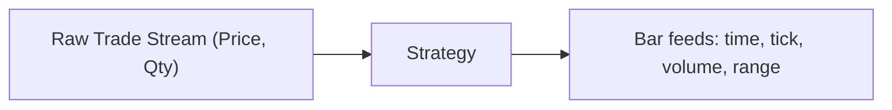

# Domain Architecture & Execution Lifecycle Specification

> **Status (2026-11-17):** sizing and the pre-trade rules of section 4 live in `domain::EntryGate` (`crates/domain/src/gate.rs`), which every runner asks. The `CusumFilter` and the dollar bars were removed. `RollingZScore` still exists in `crates/domain/src/analytics/`, with no user outside the domain. The rest of this document is pending its documentation review.

## 1. Architectural Philosophy
ATSNT follows Hexagonal Architecture (Ports and Adapters) with a Domain-First approach. The domain crate (`crates/domain`) contains pure, deterministic business logic with zero network, zero I/O, and zero asynchronous runtime dependencies.

All monetary, volume, and pricing figures strictly utilize fixed-point decimal arithmetic (`rust_decimal::Decimal`). Floating-point types (`f32`, `f64`) are strictly prohibited in domain financial logic.

---

## 2. Market Data Pipeline: Trades and Bar Feeds



### 2.1 Atomic Market Events (`Trade`)
- Represents an executed market transaction.
- Invariants: `price > 0`, `quantity > 0`.
- Every strategy reacts to one `MarketEvent::Trade` per trade. There is no shared bar sampler: a
  strategy that needs bars builds them itself.

### 2.2 Streaming bar aggregators (`BarAggregator`)
- `domain::analytics::feeds` has four aggregators that turn trades into `FeedBar`s when their closing
  rule fires: `TimeBarAggregator` (UTC-aligned buckets), `TickBarAggregator` (trade count),
  `VolumeBarAggregator` (base volume) and `RangeBarAggregator` (relative high-low range). The swarm
  runs 16 of them; see `docs/strategy/03-swarm-consensus.md` Section 5.

---

## 3. Mathematical Foundations: Rolling Z-Score

### 3.1 Dynamic Z-Score Window (`RollingZScore`)
- Maintains an in-memory sliding window of $N$ close prices using a double-ended queue (`VecDeque<Decimal>`).
- Features $O(1)$ mean update via running sum maintenance.
- Computes population standard deviation:
  $$\mu = \frac{1}{N}\sum_{i=0}^{N-1} x_i, \quad \sigma = \sqrt{\frac{1}{N}\sum_{i=0}^{N-1} (x_i - \mu)^2}, \quad Z = \frac{x_t - \mu}{\sigma}$$
- **Edge-case Protection**: If $\sigma = 0$ (flat price line), $Z$ resolves cleanly to $0$ without zero-division panics. While window length is less than $N$, queries return `None` (warm-up phase).

---

## 4. Execution Lifecycle: The 3-Stage Pipeline

To prevent state desynchronization between trading logic and exchange state, execution is decoupled into three distinct stages:

```text
[ Strategy ]             [ Risk Manager ]                 [ Exchange / Backtest Engine ]              [ Position  ]
     │                           │                                       │                                  │
     │ 1. OrderIntent            │                                       │                                  │
     ├──────────────────────────►│                                       │                                  │
     │   (Direction, Reference,  │ 2. Order                              │                                  │
     │    Dynamic SL, TP)        ├──────────────────────────────────────►│                                  │
     │                           │   (Quantity sized to 1% risk,         │                                  │
     │                           │    Status: PendingNew)                │ 3. Executed Fills                │
     │                           │                                       ├─────────────────────────────────►│
     │                           │                                       │   (Order transitions to Filled)  │ Updates:
     │                           │                                       │                                  │ Position { Size, Entry, PnL }
```

### 4.1 Stage 1: Strategy Intent (`OrderIntent`)
- Represents an unverified trading wish emitted by a strategy.
- Contains directional intent (`Side`), target price, and the three barrier thresholds:
  - **Stop Loss Barrier**: Price invalidating the statistical hypothesis ($Z = \pm 3.5$).
  - **Take Profit Barrier**: Price reverting to equilibrium ($Z = 0$).
  - **Time Barrier**: Maximum holding duration, as a deadline timestamp or a count of price events.

### 4.2 Stage 2: Managed Order Finite State Machine (`Order`)
- Governs the exact order lifecycle on the broker/exchange.
- **Allowed State Transitions**:
  - `PendingNew` $\rightarrow$ `New` (Accepted by exchange book)
  - `PendingNew` $\rightarrow$ `Canceled` or `Rejected`
  - `New` $\rightarrow$ `PartiallyFilled` (Trade matched against book depth)
  - `New` $\rightarrow$ `Filled` (Completed fill)
  - `New` $\rightarrow$ `Canceled`
  - `PartiallyFilled` $\rightarrow$ `Filled` or `Canceled`
- **Illegal Transitions**: Attempting to cancel a `Filled` order or filling a `Canceled`/`Rejected` order triggers a `DomainError::InvalidStateTransition`.
- **Overfill Protection**: Accumulated fills cannot exceed original order quantity (`DomainError::OverfillError`).

### 4.3 Stage 3: Exposure Accounting (`Position`)
- Tracks active inventory and financial risk.
- **Mark-to-Market Accounting**: Computes real-time unrealized PnL:
  - Long: $(P_{\text{current}} - P_{\text{entry}}) \times \text{Quantity}$
  - Short: $(P_{\text{entry}} - P_{\text{current}}) \times \text{Quantity}$
- **Scale-in**: Adding to an existing position calculates weighted average entry price.
- **Scale-out**: Reducing or exiting positions locks in realized PnL.

---

## 5. Telemetry, Auditability & Event Logging
For simulations and live trading post-mortem analysis:
1. Every state mutation (`OrderIntent` emission, `Order` transition, `Fill`, `Position` change) produces a structured, timestamped domain event.
2. The backtest simulator and live adapters record these events to an in-memory ledger that can be serialized to JSON/Parquet for charting and visual reconstruction on the web dashboard.
