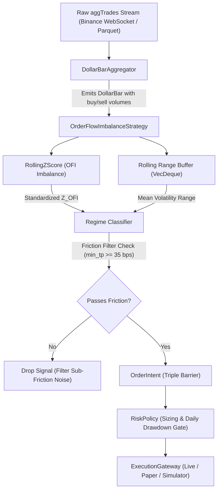

# Strategy Specification: Order Flow Imbalance & Liquidity Absorption (OFI)

## 1. Objective
Establish an institutional-grade, mathematically sound microstructure trading strategy in 100% Rust that extracts alpha from aggressive order flow imbalance, informed liquidity sweeping, and passive liquidity absorption (iceberg order walls) on high-frequency crypto asset markets.

---

## 2. Mathematical Foundation

### 2.1 Information-Driven Sampling & Volume Partitioning
Standard calendar time bars ($1m, 5m, 1h$) suffer from severe heteroscedasticity, clustering, and intraday seasonal volatility humps. Following Marcos López de Prado's *Advances in Financial Machine Learning* (AFML Ch. 2), we sample market transactions into **Dollar Bars** parameterized by dollar volume threshold $\theta_{\text{dollar}}$:

Given a stream of continuous trade ticks $t \in \{1, \dots, T\}$ with execution price $p_t$ and volume $v_t$:
$$\text{Dollar Volume: } dv_t = p_t \cdot v_t$$

Ticks accumulate until the threshold is cleared:
$$\sum_{t=t_{k-1}+1}^{t_k} dv_t \ge \theta_{\text{dollar}}$$

Within each bar $k$, volume is strictly segregated into aggressive buyer-initiated and seller-initiated volume:
- $V_{\text{buy}, k} = \sum_{t \in \text{bar}_k, \text{is\_buyer\_maker} = \text{false}} v_t$
- $V_{\text{sell}, k} = \sum_{t \in \text{bar}_k, \text{is\_buyer\_maker} = \text{true}} v_t$
- $V_{\text{total}, k} = V_{\text{buy}, k} + V_{\text{sell}, k}$

---

### 2.2 Normalized Order Flow Imbalance (OFI)
Raw volume difference is non-stationary and scales with total trading volume. We compute the bounded, normalized Order Flow Imbalance metric:

$$\text{OFI}_k = \begin{cases} \frac{V_{\text{buy}, k} - V_{\text{sell}, k}}{V_{\text{buy}, k} + V_{\text{sell}, k}} & \text{if } V_{\text{total}, k} > 0 \\ 0 & \text{otherwise} \end{cases}$$

Properties:
- $\text{OFI}_k \in [-1.0, 1.0]$.
- $\text{OFI}_k \to +1.0$: Complete aggressive buyer domination (takers lifting all offers).
- $\text{OFI}_k \to -1.0$: Complete aggressive seller domination (takers hitting all bids).
- $\text{OFI}_k \approx 0.0$: Symmetrical order flow equilibrium.

---

### 2.3 Standardization via Rolling Z-Score
Because volume imbalances exhibit regime clustering and structural variance shifts across different market hours, raw OFI thresholds generate false positives during quiet sessions and miss valid institutional sweeps during volatile sessions.

We standardize OFI over a rolling window of length $N$:
$$\mu_{\text{OFI}, k} = \frac{1}{N}\sum_{i=0}^{N-1} \text{OFI}_{k-i}$$
$$\sigma_{\text{OFI}, k} = \sqrt{\frac{1}{N-1}\sum_{i=0}^{N-1} (\text{OFI}_{k-i} - \mu_{\text{OFI}, k})^2}$$
$$Z_{\text{OFI}, k} = \frac{\text{OFI}_k - \mu_{\text{OFI}, k}}{\sigma_{\text{OFI}, k}}$$

An institutional order flow anomaly is detected when $|Z_{\text{OFI}, k}| \ge Z_{\text{threshold}}$ (typically $1.5 \le Z \le 2.2$).

---

### 2.4 Price Efficiency Ratio & Regime Discrimination
A naive order flow strategy assumes that buying leads to rising prices and selling leads to falling prices. In reality, large market participants often place passive limit iceberg orders to absorb aggressive liquidity without allowing price to move.

To discriminate between **Informed Aggressive Breakouts** and **Passive Liquidity Absorption**, we evaluate the **Bar Price Efficiency Ratio** $\eta_k$:

$$\Delta P_k = C_k - O_k$$
$$\text{Range}_k = H_k - L_k$$
$$\eta_k = \frac{|\Delta P_k|}{\max(\text{Range}_k, \epsilon)} \in [0.0, 1.0]$$

#### Market Regime Matrix:
1. **Regime A: Toxic Flow Breakout (Informed Momentum)**:
   - Condition: $\eta_k > \theta_{\text{absorption}}$ and $\operatorname{sgn}(\Delta P_k) = \operatorname{sgn}(Z_{\text{OFI}, k})$.
   - Mechanics: Aggressive market orders successfully swept the order book levels, displacing price proportionally.
   - Signal:
     - If $Z_{\text{OFI}, k} \ge +Z_{\text{threshold}}$ and $\Delta P_k > 0$: **Enter Long (Trend Following)**.
     - If $Z_{\text{OFI}, k} \le -Z_{\text{threshold}}$ and $\Delta P_k < 0$: **Enter Short (Trend Following)**.

2. **Regime B: Liquidity Absorption (Passive Iceberg Reversal)**:
   - Condition: $\eta_k \le \theta_{\text{absorption}}$ despite extreme $|Z_{\text{OFI}, k}| \ge Z_{\text{threshold}}$.
   - Mechanics: Huge aggressive buying or selling was completely absorbed by passive limit orders at key support/resistance without yielding price advancement (trapped aggressive traders).
   - Signal:
     - If $Z_{\text{OFI}, k} \ge +Z_{\text{threshold}}$ and $\eta_k \le \theta_{\text{absorption}}$: Aggressive buyers trapped against an iceberg sell wall $\rightarrow$ **Enter Short (Mean Reversion)**.
     - If $Z_{\text{OFI}, k} \le -Z_{\text{threshold}}$ and $\eta_k \le \theta_{\text{absorption}}$: Aggressive sellers trapped against an iceberg buy wall $\rightarrow$ **Enter Long (Mean Reversion)**.

---

### 2.5 Dynamic Triple Barrier Exits
Exits are strictly dynamic and volatility-normalized, avoiding rigid fixed-pip barriers:

1. **Rolling Bar Volatility**:
   $$\overline{\text{Range}}_k = \frac{1}{N}\sum_{i=0}^{N-1} (H_{k-i} - L_{k-i})$$

2. **Barrier Placement**:
   $$\text{Take Profit Distance: } \Delta_{\text{TP}} = \overline{\text{Range}}_k \times \text{Multiplier}_{\text{TP}}$$
   $$\text{Stop Loss Distance: } \Delta_{\text{SL}} = \max\left(\overline{\text{Range}}_k \times \text{Multiplier}_{\text{SL}}, 0.01\right)$$

3. **Time Barrier ($T_{\text{bars}}$)**:
   If neither price barrier is triggered within $T_{\text{bars}}$ Dollar Bars, the position is liquidated at market to eliminate capital lockup in dead liquidity.

---

### 2.6 Microstructure Friction Guard
In high-frequency or day-trading regimes, compressed volatility periods produce narrow ranges where $\Delta_{\text{TP}}$ is smaller than exchange round-trip costs (taker fees + slippage).

We enforce an explicit friction guard parameter `min_take_profit_pct` (e.g., $0.0035 = 35$ bps):
$$\text{Reject signal if: } \Delta_{\text{TP}} < C_k \times \text{min\_take\_profit\_pct}$$

This guarantees that every executed trade carries sufficient price expansion potential to clear all transaction costs and retain positive net expectancy.

---

## 3. Rust Architectural Mapping

### Architectural Guarantees:
- **Zero Allocations in Hot Path**: Uses pre-allocated circular buffers (`VecDeque`) with $O(1)$ push/pop and incremental sum tracking (`running_range_sum`).
- **Deterministic Fixed-Point Decimal**: All prices, volumes, ratios, and risk calculations use `rust_decimal::Decimal`. Zero floating-point types (`f32`/`f64`) are used anywhere in the domain or strategy logic.
- **Pure Hexagonal Design**: `OrderFlowImbalanceStrategy` implements the pure `Strategy` trait with zero network, file, or asynchronous runtime dependencies.

---

## 4. Hyperparameter Search Space

| Hyperparameter | Type | Default | Optimization Search Range | Description |
| :--- | :--- | :--- | :--- | :--- |
| `rolling_window_len` | `usize` | `20` | `[15, 20, 25]` | Window length for rolling mean & variance |
| `z_ofi_threshold` | `Decimal` | `1.8` | `[1.5, 1.8, 2.2]` | Standard deviations required to flag an institutional flow anomaly |
| `absorption_ratio_threshold` | `Decimal` | `0.35` | `[0.30, 0.40]` | Price efficiency boundary ($\eta$) separating absorption from breakout |
| `take_profit_vol_mult` | `Decimal` | `2.0` | `[1.5, 2.0, 2.5]` | Multiplier of rolling mean bar range for Take Profit barrier |
| `stop_loss_vol_mult` | `Decimal` | `1.5` | `[1.0, 1.5]` | Multiplier of rolling mean bar range for Stop Loss barrier |
| `time_barrier_bars` | `usize` | `12` | `[8, 12, 16]` | Maximum bars to hold before time stop exit |
| `min_take_profit_pct` | `Decimal` | `0.0035` | `[0.0025, 0.0035, 0.0050]` | Minimum required price distance to clear exchange fees and slippage |

---

## 5. Position Sizing & Pre-Trade Risk Integration

1. **Fixed Fractional Sizing**:
   $$Q = \frac{\text{Equity} \times R_{\text{trade}}}{|P_{\text{entry}} - P_{\text{stop}}|}$$
2. **Circuit Breaker Rollover**:
   Drawdown is evaluated against session peak equity and resets every calendar day at **00:00:00 UTC**, preserving multi-month backtesting and long-term production execution without premature permanent halts.
3. **Execution Context Parity**:
   Every backtest and HPO trial evaluates against realistic taker fees ($0.05\%$) and slippage penalties ($0.05\%$): entries and barrier exits are market orders.
