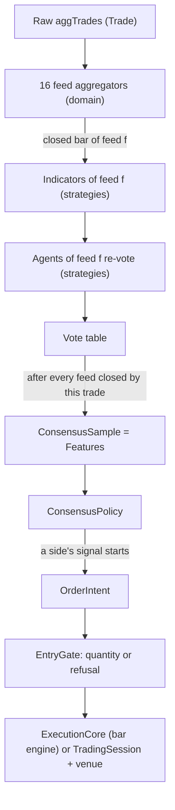

# Strategy Specification: Swarm Consensus (Multi-Agent Voting)

> **Status (2026-11-17).** The swarm is a **classifier**: its policy reads one `ConsensusSample` and
> emits a triple-barrier entry (`OrderIntent`). The earlier two-mode design (a level machine with
> target positions) was removed and is kept as history in
> [`../archive/strategy/03-swarm-consensus-niveles.md`](../archive/strategy/03-swarm-consensus-niveles.md).
> The code is the reference: `crates/strategies/src/swarm_consensus/`.

## 1. Objective and Provenance

This strategy ports, corrects, and extends the multi-agent Expert Advisor of the author's master's
thesis ("Multiagencia para el Trading", Universidad de Sevilla, 2026; source
`github.com/f92esmup/tfm-clips`). The original ran in MetaTrader 5 on EUR/USD, long-only, with
100 CLIPS rule-engine agents behind a C++ DLL.

The goal is **not bit-exact parity**. ATSNT keeps the idea, fixes the defects found in the
original, and adds:

- **short selling**, through mirrored rules generated from one definition;
- **all 16 bar feeds** (time, tick, volume, range), calibrated for BTCUSDT;
- **triple-barrier entries**: each signal enters one side with a stop, a take profit and a time
  barrier, sized by the account's risk rules, and it runs on spot (long only) as well as on perpetuals.

The whole port is 100% Rust: no FFI, no rule-engine runtime, no strings between layers.

Scope of this specification: backtest (bar and tick fill models) and HPO. The strategy runs on the
repository's **single** execution model: one engine, one venue contract, one registry and one
optimiser (Section 3). There is no paper or live loop (Section 17).

The idea in one paragraph: the market is the result of many independent participants, so the
strategy models it with many independent agents. Each agent watches one bar feed. It reads
the market through its own randomly sampled thresholds (its *genome*) and votes. No agent decides
alone. When the net vote of one side clears a threshold, the policy enters that side with a stop, a
take profit and a time barrier, and the engine holds the position until a barrier closes it.

---

## 2. Glossary

| Term | Meaning |
| :--- | :--- |
| Feed | One bar stream built from raw trades (for example "time bars of 1h"). There are 16. |
| Closed bar | A bar that has finished. Agents only ever see closed bars. |
| Genome | The 11 thresholds of one agent, sampled once at construction. |
| Agent | A genome plus a feed id. It is stateless; its vote is a pure function of its inputs. |
| Macro state | Discrete reading of the four indicators (direction, momentum, volatility, liquidity). |
| Micro set | The set of candle patterns found on the agent's feed (pin bar, engulfing, inside bar, break of structure). |
| Rule | A condition over the macro state and micro set that produces one action. |
| Action | One of `LongEntry`, `LongExit`, `ShortEntry`, `ShortExit`. |
| Vote | Per agent, a pair `(long_vote, short_vote)`, each in `{-1, 0, +1}`. |
| Net vote | Per axis, the sum of the agents' votes divided by the number of agents (range -1 to +1). |
| Entry | What a strategy returns: an `OrderIntent` with a side, a signal price, a stop, a take profit and a time barrier. |
| Features | The output of a strategy's first, frozen stage. For the swarm, a `ConsensusSample`. |
| Price event | An OHLC bucket of trades (one trade, or a bucket of trades such as 1 s) that the execution core fills against. |

---

## 3. Architecture: One Engine for Every Strategy

### 3.1 Principle

This strategy gets **no private copy** of any mechanism the repository already has. It adds new
pieces only where none exists: bar feeds, indicators and calibration. Each new piece is
general-purpose, so any future strategy can use it. Every runner keeps exactly one of each:

| Concern | The single component | Used by |
| :--- | :--- | :--- |
| What a strategy decides | `domain::OrderIntent`, a triple-barrier entry | every strategy |
| How a strategy is called | `strategies::Strategy::on_event` | engine, session, contract tests |
| How a strategy is optimised | `strategies::OptimizableStrategy` (two stages) | `run_hpo`, registry |
| How an intent becomes a quantity or a refusal | `domain::EntryGate` (`RiskPolicy::size_order`, the margin rule, the daily breaker) | engine, session |
| How fills become position and trades | `ExecutionCore` with its `TradeLedger` | bar engine, session |
| How orders reach a venue | `ports::ExecutionVenue` + `ports::ExitGateway` | session (simulated venue) |
| Which strategies exist | `register_strategies!` | every runner |

### 3.2 One decision type

```rust
// crates/domain
pub struct OrderIntent {
    pub timestamp: i64,
    pub side: Side,
    pub price: Decimal,                 // the signal price: sizing reference
    pub stop_loss: Decimal,
    pub take_profit: Decimal,
    pub deadline_ms: i64,               // time barrier: timestamp + the decay horizon
    pub risk_fraction: Option<Decimal>, // overrides the account's risk per trade
    pub trailing_atr: Option<Decimal>,  // trailing step distance
    pub breakeven_atr: Option<Decimal>, // favourable excursion that moves the stop to entry
    // ...order type and time in force
}

pub struct ProtectiveExits {
    pub stop: Decimal,
    pub take_profit: Option<Decimal>,
    pub deadline_ms: Option<i64>,       // `Some` for every triple-barrier entry
    // ...trailing and breakeven distances
}
```

A strategy pushes `Decision`s: `Enter(OrderIntent)` or `Exit`. The gate turns an entry into a
quantity (Section 11.3), and the execution core carries `ProtectiveExits::from_intent` with the
position until a barrier or an `Exit` closes it. Only one position is open at a time: an entry that
arrives while the account is not flat is ignored. The swarm decides entries only; its barriers
close its positions.

### 3.3 One strategy contract

```rust
// crates/domain
#[non_exhaustive]
pub enum MarketEvent<'a> { Trade(&'a Trade) }

// crates/strategies
pub trait Strategy: Send {
    fn name(&self) -> &str;
    fn compatible_market_types(&self) -> &'static [MarketType];
    fn on_event(&mut self, event: &MarketEvent, view: &StrategyView, out: &mut Vec<Decision>);
    fn reset(&mut self);
    /// Strategy-specific audit written into reports as `strategy_audit`. Default: None.
    fn audit(&self) -> Option<serde_json::Value> { None }
}
```

- Every runner feeds the strategy one `MarketEvent::Trade` per aggTrade. The strategy builds its own
  bars (Section 5).
- Runners never match on a strategy name (`architecture_contract.rs` enforces it); they ask the
  registry and call the trait.
- The swarm is compatible with `Spot` and `UsdMPerpetual`. On spot the registry narrows the shared
  configuration to `allow_short = false` and reports it.

### 3.4 One optimisation contract: two stages for every strategy

```rust
pub trait FeatureExtractor: Send {
    type Features: Clone + Send + Sync + 'static;
    fn on_event(&mut self, event: &MarketEvent) -> Option<Self::Features>;
    fn reset(&mut self);
}

pub trait OptimizableStrategy: Strategy + Sync + Sized {
    type SharedConfig; // frozen for a whole HPO run (config bounds + Default)
    type Config;       // searched (config bounds)
    type Space: HyperparameterSpace<Config = Self::Config>;
    type Extractor: FeatureExtractor;
    fn id() -> &'static str;
    fn from_config(shared: &Self::SharedConfig, config: Self::Config) -> Result<Self, DomainError>;
    fn extractor(shared: &Self::SharedConfig) -> Result<Self::Extractor, DomainError>;
    fn on_features(
        &mut self,
        features: &<Self::Extractor as FeatureExtractor>::Features,
        view: &StrategyView,
        out: &mut Vec<Decision>,
    );
    fn default_space() -> Self::Space;
    fn shared_for_market(shared: Self::SharedConfig, market: MarketType) -> Self::SharedConfig;
}
```

The strategy **is** its own decision stage: there is no wrapper type. One instance serves both
uses:

- **Engines and sessions** call `Strategy::on_event`.
- **The HPO** builds the extractor once and calls `on_features` on fresh instances, one per
  candidate.

For the swarm:

- `SharedConfig` is the structural configuration (Section 14.1);
- `Extractor` is `SwarmEnsemble`;
- `on_features` runs the `ConsensusPolicy` on a `ConsensusSample`;
- `on_event` is the extractor followed by `on_features`, so the two stages cannot drift.

The contract suite enforces it: extractor + `on_features` must decide exactly what `on_event`
decides on the same synthetic input (`crates/strategies/src/contract.rs`). The HPO runs the
extractor **once per run** and replays only `on_features` per candidate (Section 15). A future
machine-learning strategy fits the same shape: a frozen model as the extractor, thresholds as the
decision stage.

### 3.5 One execution core

`ExecutionCore` (crate `application`) holds:

- position state (`domain::Position`);
- the pending order and its due time;
- `ProtectiveExits`;
- margin and liquidation;
- funding;
- fill price, slippage, and fee math;
- the `TradeLedger`, which turns fills into `ClosedTrade`s.

`BacktestEngine` (crate `backtest`) keeps its loop (rollovers, breakers, kill switch, mark to
market, excursion) and delegates the rest to the core.

A **price event** is what the core trades against:

- at trade resolution (`--fill-model bar`) it is one trade;
- in HPO it is a bucket of trades, 1 s by default (`--price-bucket-ms`).

### 3.6 One venue contract

The session path (`--fill-model tick`) executes the same intents through the ports:

- `ExecutionVenue::submit_order(symbol, OrderRequest { side, quantity, reduce_only }) -> EntryAck`
  sends a market order of an explicit quantity. The venue sizes nothing and applies no risk rule;
  it only refuses what the balance cannot margin.
- `ExitGateway::place_exits(symbol, entry_side, stop_loss, take_profit: Option<Decimal>)` places the
  stop and the take profit the venue holds for the position.

`TradingSession` asks the same `EntryGate` as the bar engine, sends the admitted quantity with
`submit_order`, installs the exits when the entry fills, and books the closed trade through the
same `TradeLedger`.

### 3.7 Data flow of this strategy



- **Stage A**, the extractor: expensive, frozen during HPO.
- **Stage B**, the policy: cheap, searched.

---

## 4. Market and Data

- Instrument: BTCUSDT, on the USD-M perpetual (`MarketType::UsdMPerpetual`) or on spot, where the swarm is long only (`allow_short = false`).
- Input: Binance futures aggTrades loaded through the existing readers (`BinanceParquetReader`,
  `BinanceCsvReader`) as `domain::Trade { timestamp, price, quantity, side }`.
- A "tick" in this document is one aggTrade. The domain has no raw trade ids, so tick bars count
  aggTrades.
- Volume is base-asset quantity (BTC). The original used MT5 tick volume because forex has no real
  volume.
- All prices, quantities, indicator values, thresholds, and balances are `rust_decimal::Decimal`.
  No `f32`/`f64` exists anywhere in this strategy, including genome sampling (Section 7.2).

---

## 5. The 16 Feeds

### 5.1 Feed table

Four bar types × four horizons. Feed ids are fixed and ordered:

| id | Type | Horizon | Threshold |
| :-: | :--- | :--- | :--- |
| 0 | Time | 5m | 300,000 ms |
| 1 | Time | 1h | 3,600,000 ms |
| 2 | Time | 4h | 14,400,000 ms |
| 3 | Time | 1d | 86,400,000 ms |
| 4 | Tick | ≈5m | aggTrades per bar, calibrated |
| 5 | Tick | ≈1h | calibrated |
| 6 | Tick | ≈4h | calibrated |
| 7 | Tick | ≈1d | calibrated |
| 8 | Volume | ≈5m | BTC per bar, calibrated |
| 9 | Volume | ≈1h | calibrated |
| 10 | Volume | ≈4h | calibrated |
| 11 | Volume | ≈1d | calibrated |
| 12 | Range | ≈5m | relative range `(high - low) / open`, calibrated |
| 13 | Range | ≈1h | calibrated |
| 14 | Range | ≈4h | calibrated |
| 15 | Range | ≈1d | calibrated |

### 5.2 Bar contents

Every feed emits a `FeedBar`:

- `start_time` and `end_time` (inclusive, ms);
- `open`, `high`, `low`, `close`;
- `volume` (sum of base quantity);
- `trade_count`.

### 5.3 Aggregation rules

**Time bars** (corrects the drift in the original, which started a bar at the tick that closed the
previous one):

- Bars are aligned to UTC epoch multiples of the horizon. Bucket `b` covers
  `[b·Δ, (b+1)·Δ)`.
- A trade belongs to the bucket that contains its timestamp.
- The bar of bucket `b` is emitted when the first trade with `timestamp ≥ (b+1)·Δ` arrives. That
  trade **does not belong** to the emitted bar; it opens the next one. This is the only way a
  trade-driven replay learns that a clock interval ended, and it cannot leak future data into the
  closed bar.
- Empty buckets emit no bar. On BTCUSDT a 5m bucket without trades is practically impossible, and
  inventing a flat bar would distort RSI and ATR.

**Tick, volume, and range bars**:

- The trade that reaches the threshold **belongs** to the bar it closes. The next trade opens a
  new bar.
- Tick: close when `trade_count ≥ threshold`.
- Volume: close when `volume ≥ threshold`. Excess volume is **not** carried into the next bar:
  carrying it over would count the same volume in two bars.
- Range: close when `(high - low) / open ≥ threshold`. A single trade that jumps far past the
  threshold still closes the bar on that trade; the bar keeps its true high and low.

A partial bar at the end of the data is never emitted.

### 5.4 Calibration of tick, volume, and range thresholds

The original used fixed EUR/USD numbers (ticks 100/1500/6000/24000, volume 500/5000/20000/80000,
range 50/200/500/1500 points). They mean nothing on BTCUSDT. ATSNT calibrates every threshold
so that the feed's **mean bar duration equals its time counterpart** (5m, 1h, 4h, 1d). This
makes the four bar types comparable horizons instead of arbitrary numbers.

Over a calibration period with `N` aggTrades, total volume `V`, and duration `T` ms, for a target
duration `Δ`:

- tick threshold `= ceil(N · Δ / T)`;
- volume threshold `= V · Δ / T`, rounded to 3 decimals;
- range threshold: the value `r` for which a range-bar pass over the calibration period yields
  `round(T / Δ)` bars. Bar count decreases monotonically in `r`, so `r` is found by bisection on
  `[0.00001, 0.5]` until the count is within 1% of the target, or after 60 iterations. It is
  rounded to 6 decimals.

**No look-ahead**: the calibration period must end **strictly before** the first trade of any data
the strategy is evaluated on. The run refuses a configuration whose calibration end is not
earlier than its data start (Section 15.2). Thresholds are part of the frozen structural
configuration and are written into the artifact.

### 5.5 Rolling window

Each feed keeps the last `history_size = 50` closed bars in a fixed-capacity ring buffer. Index 0
is the most recent closed bar, index 1 the one before it, and so on. The bar in formation is never
visible to indicators or agents.

---

## 6. Indicators (per feed)

Indicators are computed once per feed (16 feeds × 5 values), not per agent, and updated **only
when that feed closes a bar**. All are incremental where the math allows it.

Notation: `C_t`, `H_t`, `L_t` are the close, high, and low of the bar that just closed; `C_{t-1}`
is the previous close.

### 6.1 RSI (Wilder, period 14)

- Change `d_t = C_t - C_{t-1}`. Gain `g_t = max(d_t, 0)`. Loss `l_t = max(-d_t, 0)`.
- Seed: after the first 14 changes, `G = mean(g)` and `L = mean(l)` (simple mean).
- Then `G = (G·13 + g_t) / 14` and `L = (L·13 + l_t) / 14`.
- `RSI = 100` if `L = 0`, otherwise `RSI = 100 - 100 / (1 + G/L)`.
- Ready after 15 closed bars. Range: 0 to 100.

### 6.2 ATR (Wilder, period 14) and ATR ratio

- `TR_t = max(H_t - L_t, |H_t - C_{t-1}|, |L_t - C_{t-1}|)`.
- Seed: the simple mean of the first 14 TRs. The original seeded with a single TR, which biased
  early values; that is fixed here.
- Then `ATR = (ATR·13 + TR_t) / 14`.
- `ATR` is ready after 15 closed bars. It is expressed in price units and used for normalisation
  and for the stop.
- **ATR ratio** (the volatility dimension): `atr_ratio_t = ATR_t / mean(ATR over the last 50 ATR
  values)`. It is adimensional: 1.0 means "typical volatility for this feed". It is ready after
  64 closed bars (15 + 49).

The original compared raw ATR against a per-feed table `base_atr[16]` of EUR/USD constants, and a
`%.2f` formatting bug turned those thresholds into `0.00` (Section 13, C1). The ratio replaces both.

### 6.3 ALMA slope (period 9, offset 0.85, sigma 6)

- `m = 0.85 · (9 - 1) = 6.8` and `s = 9 / 6 = 1.5`.
- Weights `w_i = exp(-(i - m)² / (2 s²))` for `i = 0..8`, where `i = 0` is the **oldest** of the
  last 9 closes and `i = 8` the most recent. They are computed once in `Decimal`, through
  `MathematicalOps::exp`.
- `ALMA_t = Σ w_i · C_i / Σ w_i`.
- **Normalised slope** (the direction dimension): `alma_slope_t = (ALMA_t - ALMA_{t-1}) / ATR_t`,
  in ATR units per bar.
- Ready when both ALMA values and ATR exist (from closed bar 15 on).

The original compared the raw slope against `base_alma[16]` constants (price units per feed).
Normalising by ATR makes one genome prior valid for every feed and every asset.

### 6.4 VWAP deviation (window 50)

- Typical price `P_i = (H_i + L_i + C_i) / 3`.
- `VWAP = Σ P_i · volume_i / Σ volume_i` over the last 50 closed bars. It is undefined if the
  volume sum is 0.
- **Deviation** (the liquidity dimension): `vwap_dev_t = |C_t - VWAP| / ATR_t`, in ATR units.
- Ready after 50 closed bars (and ATR ready).

The original used a percentage with one constant prior (0.15%) for every feed. A 0.15% move is 3
ATR on M5 and 0.2 ATR on D1, so the prior meant different things on every feed. ATR units fix that.

### 6.5 Feed readiness

A feed is **warm** when every value above is ready: 64 closed bars, set by the ATR ratio. Agents of
a cold feed vote `(0, 0)`.

---

## 7. The Genome

### 7.1 Parameters and priors

Each agent samples 11 thresholds once, in this fixed order:

| # | Gene | Unit | Prior (mean, std) | Clamp | Original (TFM) |
| :-: | :--- | :--- | :--- | :--- | :--- |
| 1 | `rsi_overbought` | RSI points | N(70, 3.5) | [50, 85] | N(70, 3.5), max 85 |
| 2 | `rsi_oversold` | RSI points | N(30, 3.5) | [15, 50] | N(30, 3.5), min 15 |
| 3 | `atr_expansion` | ATR ratio | N(1.0, 0.2) | [0.5, 3.0] | base_atr·N(1, 0.2), price units |
| 4 | `atr_contraction` | ATR ratio | N(0.5, 0.1) | [0.1, `atr_expansion` − 0.05] | base_atr·N(0.5, 0.1), price units |
| 5 | `vwap_deviation` | ATR units | N(1.0, 0.33) | [0.1, 5.0] | N(0.15%, 0.05%) |
| 6 | `alma_slope` | ATR units per bar | N(0.07, 0.014) | [0.005, 1.0] | base_alma·N(1, 0.2), price units |
| 7 | `pinbar_long_ratio` | body multiples | N(2.8, 0.4) | [1.5, 10] | same, min 1.5 |
| 8 | `pinbar_short_ratio` | body multiples | N(0.3, 0.05) | [0.1, 1.0] | same, min 0.1 |
| 9 | `engulfing_ratio` | body multiples | N(1.15, 0.05) | [1.01, 3.0] | same, min 1.01 |
| 10 | `bos_margin` | ATR units | N(0.0, 0.07) | [−0.5, 0.5] | N(0, 0.0001), price units |
| 11 | `insidebar_ratio` | range fraction | N(0.7, 0.08) | [0.1, 1.0] | same, no clamp |

How the converted priors were derived (assumption, revisable):

- `alma_slope`: the original ratio `base_alma / base_atr` per feed was 0.04, 0.067, 0.083, and 0.1.
  Their centre, about 0.07 ATR per bar, keeps the same demand for trend strength; the standard
  deviation keeps the original 20% coefficient of variation.
- `vwap_deviation`: 0.15% was about 1 ATR on the H1 feed the thesis was tuned on. The standard
  deviation keeps the original one-third coefficient of variation.
- `bos_margin`: 0.0001 was about 0.07 ATR on H1.
- New clamps (rows 1 lower bound, 2 upper bound, 3, 4, 5, 6, 11) close gaps where the original
  could sample impossible values: a negative VWAP threshold, contraction above expansion, or an
  inside-bar ratio above 1.

Clamping puts a small probability mass at the bounds. That is accepted and audited (Section 16).

### 7.2 Deterministic sampling without floats

- RNG: `rand_chacha::ChaCha12Rng::seed_from_u64(genome_seed)` (the generator behind `StdRng` in `rand` 0.8, named so a `rand` upgrade cannot change a swarm; tests pin the first genomes), with `genome_seed = 123456` by default (the
  thesis seed). One RNG serves the whole swarm. Agents are sampled in id order and genes in table
  order, so a seed fully determines the swarm.
- Uniforms: `u = (next_u32() as Decimal + 1) / 2^32`, giving `u ∈ (0, 1]` (never 0, so `ln` is
  defined).
- Standard normal through Box–Muller in `Decimal`:
  `z = sqrt(-2·ln(u1)) · cos(2π·u2)`, using `MathematicalOps` (`ln`, `sqrt`, `cos`).
  Each normal consumes two uniforms; the sine branch is discarded, as in the original.
- Gene `= mean + std·z`, rounded to 8 decimal places, then clamped.
- The original `MathRand` stream is not reproducible outside MQL5, so the agents differ from the
  thesis while following the same distributions.

### 7.3 Agent-to-feed assignment

- `agents_per_feed = 6` (configurable, ≥ 1), so `N = 16 · agents_per_feed = 96` agents.
- Agent `i` subscribes to feed `i / agents_per_feed` (integer division): agents 0–5 watch feed 0,
  agents 6–11 feed 1, and so on.
- The original used `i % 16` with 100 agents, which gave feeds 0–3 seven agents and the rest six:
  a 17% extra weight on four feeds that nobody chose. Stratified assignment removes it.

### 7.4 Meta-Priors and Stratified Agent Pruning (Bloque D)

To adapt the agent population to cryptocurrency microstructures without dimensional explosion ($1\,056$ independent genes):
1. **Configurable Meta-Priors (`SwarmPriorsConfig`)**:
   Instead of hardcoding [`GENE_PRIORS`], the prior means $\boldsymbol{\mu}$, standard deviations $\boldsymbol{\sigma}$, and clamp limits are encapsulated in `SwarmPriorsConfig` within `SwarmConfig`.
2. **Empirical Prior Calibration**:
   The `calibrate_feeds` binary supports `--calibrate-priors`. It analyzes empirical distributions (RSI quantiles, wick-to-body ratios, ALMA momentum dispersion, and bar ratios) over the warm-up trades to derive asset-tailored priors.
3. **Stratified Agent Pruning (`prune_swarm`)**:
   An expanded candidate swarm ($N_{\text{cand}} = 16 \times 12 = 192$ agents) is simulated over calibration trades. Each agent's votes are scored against their feed's forward returns ($S_i = \sum v_{i,t} \cdot R_{t \to t+1}$). The top $K=6$ agents per feed are preserved in `SwarmConfig.custom_agents`, eliminating noise while maintaining strict feed balance.

---

## 8. The Agent

An agent's vote is a pure function:

```text
vote(genome, indicators_of_feed, last_50_closed_bars_of_feed) -> (long_vote, short_vote)
```

It is evaluated in three stages, which replace the CLIPS `focus MACRO MICRO DECISION`.

### 8.1 Macro stage: the market regime

Each dimension produces at most one state. Comparisons are strict, as in the original.

| Dimension | State | Condition |
| :--- | :--- | :--- |
| direction | `Bullish` | `alma_slope > alma_slope_gene` |
| direction | `Bearish` | `alma_slope < -alma_slope_gene` |
| momentum | `Overbought` | `RSI > rsi_overbought` |
| momentum | `Oversold` | `RSI < rsi_oversold` |
| volatility | `High` | `atr_ratio > atr_expansion` |
| volatility | `Low` | `atr_ratio < atr_contraction` |
| liquidity | `Stretched` | `vwap_dev > vwap_deviation` |

`atr_contraction < atr_expansion` is guaranteed by the clamp, so `High` and `Low` never coexist.
`Stretched` has no direction because the deviation is an absolute value.

### 8.2 Micro stage: price topology

Bar 0 is the last closed bar, and bar 1 the one before it. `body0 = |C0 - O0|`. Every detector
runs; none short-circuits another. The result is a **set** of `(pattern, direction)`.

| Pattern | Direction | Condition |
| :--- | :--- | :--- |
| Pin bar | Up | `C0 ≥ O0`, `H0 > L0`, lower wick `O0 - L0 > 0`, `O0 - L0 ≥ pinbar_long_ratio · body0`, `H0 - C0 ≤ pinbar_short_ratio · body0` |
| Pin bar | Down | `C0 ≤ O0`, `H0 > L0`, upper wick `H0 - O0 > 0`, `H0 - O0 ≥ pinbar_long_ratio · body0`, `C0 - L0 ≤ pinbar_short_ratio · body0` |
| Engulfing | Up | `C0 > O0`, `C1 < O1`, `O0 ≤ C1`, `C0 ≥ O1`, `(C0 - O0) > engulfing_ratio · (O1 - C1)` |
| Engulfing | Down | `C0 < O0`, `C1 > O1`, `O0 ≥ C1`, `C0 ≤ O1`, `(O0 - C0) > engulfing_ratio · (C1 - O1)` |
| Inside bar | Neutral | `H0 < H1`, `L0 > L1`, `(H0 - L0) ≤ insidebar_ratio · (H1 - L1)` |
| Break of structure | Up | at least one earlier bar, and every bar `j ∈ 1..len-1` has `H_j < C0 - bos_margin · ATR` |
| Break of structure | Down | at least one earlier bar, and every bar `j ∈ 1..len-1` has `L_j > C0 + bos_margin · ATR` |

Notes on fidelity:

- The pin-bar-up detector adds `H0 > L0` and a strictly positive lower wick (correction C10). In
  the original, a flat bar (`O = H = L = C`) satisfied the bullish pin bar: zero body makes both
  wick inequalities trivially true. Flat bars are common on small tick bars.
- The pin-bar-down detector is the exact mirror of the up detector (user decision, 2026-10-20). The original required `C0 < O0`, so a gravestone doji (`O = C = L < H`) was never a bearish pin bar, while its mirror, the dragonfly doji, was a bullish one. That asymmetry broke the reflection invariant of §8.4.
- The break of structure compares against every bar in the 50-bar window, as the CLIPS
  `(not (vela ...))` pattern did. The margin is now in ATR units (correction C5).
- An empty micro set is **noise**.

### 8.3 Decision stage: the rule table

The rules come from `03_decision.clp`. Each original rule acts on the long axis. Its mirror acts on
the short axis and is **generated**, not hand-written, by this transformation:

- `Bullish ↔ Bearish`;
- `Overbought ↔ Oversold`;
- pattern direction `Up ↔ Down`;
- `High`, `Low`, `Stretched`, and `Neutral` stay as they are;
- `LongEntry → ShortEntry` and `LongExit → ShortExit`.

Long-axis rules (the original, with names kept for traceability):

| Id | CLIPS rule | Condition | Action |
| :--- | :--- | :--- | :--- |
| E1 | `decision-comprar-continuacion-alcista` | `Bullish ∧ High ∧ (PinBar↑ ∨ Engulfing↑)` | `LongEntry` |
| E2 | `decision-comprar-ruptura-estructural` | `Bullish ∧ BoS↑` | `LongEntry` |
| E3 | `decision-comprar-rebote-sobrevendido` | `Oversold ∧ Stretched ∧ (PinBar↑ ∨ Engulfing↑)` | `LongEntry` |
| E4 | `decision-comprar-acumulacion` | `Bullish ∧ Low ∧ InsideBar` | `LongEntry` |
| E5 | `decision-comprar-fuerza-bruta` | `Bullish ∧ High ∧ ¬Overbought ∧ (BoS↑ ∨ Engulfing↑)` | `LongEntry` |
| X1 | `decision-reducir-agotamiento-alcista` | `Overbought ∧ (PinBar↓ ∨ BoS↓)` | `LongExit` |
| X2 | `decision-reducir-falta-liquidez` | `Stretched ∧ InsideBar` | `LongExit` |
| X3 | `decision-reducir-cambio-tendencia` | `Bearish` | `LongExit` |
| X4 | `decision-reducir-freno-volatilidad` | `Low ∧ Overbought` | `LongExit` |

Short-axis mirrors, generated:

| Id | Condition | Action |
| :--- | :--- | :--- |
| E1′ | `Bearish ∧ High ∧ (PinBar↓ ∨ Engulfing↓)` | `ShortEntry` |
| E2′ | `Bearish ∧ BoS↓` | `ShortEntry` |
| E3′ | `Overbought ∧ Stretched ∧ (PinBar↓ ∨ Engulfing↓)` | `ShortEntry` |
| E4′ | `Bearish ∧ Low ∧ InsideBar` | `ShortEntry` |
| E5′ | `Bearish ∧ High ∧ ¬Oversold ∧ (BoS↓ ∨ Engulfing↓)` | `ShortEntry` |
| X1′ | `Oversold ∧ (PinBar↑ ∨ BoS↑)` | `ShortExit` |
| X2′ | `Stretched ∧ InsideBar` | `ShortExit` |
| X3′ | `Bullish` | `ShortExit` |
| X4′ | `Low ∧ Oversold` | `ShortExit` |

X2 and X2′ have the same condition. "Stretched and compressed" is a direction-free reason to
reduce exposure on both sides.

The rules live in one constant table: `const LONG_RULES: &[Rule]`, plus `mirror(&Rule) -> Rule`.
Each `Rule` has an id, an action, and a condition built from a small combinator type
(`All`, `Any`, `Not`, `Macro(state)`, `Micro(pattern, direction)`). Conditions are data, not
branches, so the mirror is mechanical and testable.

### 8.4 Vote resolution (no priority bias)

The original returned the **first** `voto` fact CLIPS had asserted, so the Rete agenda order
silently decided between contradictory rules (correction C3). An `if / else if` chain has the same
defect in plain sight: the first true branch wins, and the source order becomes an undeclared
priority. ATSNT evaluates **every** rule and resolves explicitly:

1. **Cold feed**: the vote is `(0, 0)`.
2. **Noise veto**: if the micro set is empty, the vote is `(0, 0)` whatever the macro stage says.
   This follows the documented intent of `decision-esperar-por-ruido` ("el agente no opera, sin
   importar lo que digan los indicadores macro"). As a consequence, the macro-only rules X3, X4,
   X3′, and X4′ only act when some pattern exists.
3. Collect the set of fired actions `A`.
4. Long axis: `+1` if `LongEntry ∈ A` and `LongExit ∉ A`; `-1` if `LongExit ∈ A` and
   `LongEntry ∉ A`; otherwise `0`. **Both present is a conflict, which gives `0` (wait)**, as the
   user decided.
5. Short axis, the same with `ShortEntry` and `ShortExit`.
6. **Directional conflict**: if `LongEntry ∈ A` and `ShortEntry ∈ A`, both axes become 0.
7. Long-only mode (`allow_short = false`): mirrored rules are not evaluated and the short vote is
   always 0. With that, steps 3–4 reproduce the original decision module with the conflict policy
   made explicit.

Combinations that are **not** conflicts, because they agree in direction:

- `LongExit` with `ShortEntry` gives `(-1, +1)`, which is bearish.
- `LongEntry` with `ShortExit` gives `(+1, -1)`, which is bullish.
- `LongExit` with `ShortExit` gives `(-1, -1)`, which means "get flat".

Every evaluation records whether a conflict happened (step 4, 5, or 6) for the audit.

Invariants (each is a test):

- Permuting `LONG_RULES` never changes any vote.
- **Mirror symmetry**: reflecting the inputs swaps and negates the axes. Reflecting means
  `RSI → 100 - RSI`, `alma_slope → -alma_slope`, `atr_ratio` and `vwap_dev` unchanged, and candles
  reflected `p → 2M - p` with high and low swapped.
  So `vote(reflect(x)) = (short_vote(x), long_vote(x))`.

---

## 9. The Ensemble (Stage A)

### 9.1 Event handling

For every trade, in timestamp order:

1. Feed every aggregator (feed ids 0 to 15, in order) with the trade. Collect the feeds that
   closed a bar.
2. For every closed feed, update its ring buffer and indicators, then re-evaluate **only** the
   agents subscribed to it. Store each new vote in the vote table.
3. If at least one feed closed on this trade **and** the swarm is ready, emit one
   `ConsensusSample` stamped with the trade's timestamp.

Votes **persist**: an agent keeps its last vote until its feed closes another bar, so a 1d agent
votes with yesterday's bar all day. This is the original behaviour, and it is intended: slow
feeds give slow context.

Several feeds can close on the same trade, for example every time feed at midnight. All of them
update before the single sample, so the sample never shows a half-updated swarm. That matches the
original "consensus only when the queue is empty". The MT5 queue, its three-agents-per-tick limit,
and its drop-on-full behaviour were platform workarounds and are not reproduced (correction C9).

### 9.2 Readiness

The swarm is **ready** when all 16 feeds are warm. Before that, no sample is emitted. The original
only checked the fastest feed (M5), so agents of slow feeds took part as permanent abstainers
while the thresholds still counted 100 voters (correction C8). With 64 bars needed on the 1d
feeds, readiness takes about 64 days of data. Section 15.2 covers how runs provide it.

### 9.3 ConsensusSample

`SwarmEnsemble` implements `FeatureExtractor<Features = ConsensusSample>` (Section 3.4). It accepts
only `MarketEvent::Trade`; any other event is ignored.

```text
ConsensusSample {
  timestamp: i64,              // the trade that closed the feed(s)
  agents: u32,                 // N
  agents_per_feed: u16,        // N / 16 (default 6)
  long_up: u32, long_down: u32,
  short_up: u32, short_down: u32,
  waits: u32,                  // agents with vote (0, 0)
  conflicts: u32,              // agents whose last evaluation had a conflict
  feed_long:  [FeedVote; 16],  // (up: u16, down: u16) per feed
  feed_short: [FeedVote; 16],  // (up: u16, down: u16) per feed
  atr_stop_reference: Decimal, // ATR (price units) of feed 1 (time 1h)
  price: Decimal,              // the trade price, for audit only
}
```

From it:
- Unweighted (pure democracy): `long_net = (long_up - long_down) / N` and `short_net = (short_up - short_down) / N`, both in [-1, 1].
- Weighted / Pruned: when `PolicyConfig.feed_weights` is set, `weighted_net = (1 / agents_per_feed) · Σ w_f · (up_f - down_f)`. Feeds with weight 0 are pruned. Normalization ensures the active weights sum to 1, preserving the [-1, 1] bounds.

---

## 10. The Consensus Policy (Stage B)

The policy is a **classifier**: it reads one `ConsensusSample` and either enters one side or does
nothing. It holds no position state beyond the signal it already acted on. The code is the
reference: `crates/strategies/src/swarm_consensus/policy.rs`.

### 10.1 Configuration rules

Thresholds are fractions of `N` (the original used absolute votes out of 100; fractions keep the
meaning when `agents_per_feed` changes). A configuration is valid when:

- `0 < threshold_base ≤ 1`;
- `base_risk > 0`, `risk_increment ≥ 0` and `base_risk + risk_increment ≤ 1`;
- `0 < stop_atr_multiplier ≤ 2.0`, and `take_profit_atr_multiplier ≥ 1.5 · stop_atr_multiplier`;
- a breakeven multiplier, when set, is positive and below the take profit; a trailing multiplier,
  when set, is positive;
- `decay_horizon_seconds` is between 7,200 and 86,400;
- `macro_slope_min ≥ 0` and `short_threshold_delta ≥ 0`.

A file written for the removed target-level policy (`classifier_mode: false`) is refused with a clear
error; its `threshold_step`, `hysteresis` and `bracket_priority` are ignored on load.

### 10.2 Which side

With `long_net` and `short_net` from Section 9.3 (weighted when `feed_weights` is set):

- `θ_long = threshold_base` and `θ_short = threshold_base + short_threshold_delta`;
- the **long** side is selected when `long_net ≥ θ_long` and `short_net < θ_long`;
- the **short** side, only when `allow_short`, when `short_net ≥ θ_short` and `long_net < θ_short`;
- when both sides clear their threshold the swarm contradicts itself and no side is selected,
  consistent with "conflict means wait".

With `macro_trend_filter`, a long also needs `macro_trend_slope ≥ macro_slope_min` and a
non-negative two-hour slope; a short needs the mirror. A swarm that is trending against the entry
withholds it.

### 10.3 One entry per signal

A signal is acted on once. While the same side keeps clearing its threshold, nothing more is
emitted; the signal ends when no side is selected, and the next one may enter again.

### 10.4 Risk per entry

`risk_fraction = base_risk + share · risk_increment`, where
`share = clamp((conviction − θ) / (1 − θ), 0, 1)` and `conviction` is the selected side's net vote:
the entry risks `base_risk` when it just reaches the threshold and `base_risk + risk_increment`
under a unanimous swarm. The search space bounds the largest risk by `max_risk` (default 0.05).

### 10.5 Protective exits

All distances are multiples of `atr_stop_reference`, the ATR of feed 1 (time 1h):

- **Stop**: `stop_atr_multiplier · ATR` on the losing side.
- **Take profit**: `take_profit_atr_multiplier · ATR` on the winning side.
- **Breakeven** (optional): once the favourable excursion reaches `breakeven_atr_multiplier · ATR`,
  the stop moves to the entry price.
- **Trailing** (optional): the stop ratchets in steps of `trailing_atr_multiplier · ATR` of favourable
  excursion.
- **Time barrier**: `deadline_ms = sample timestamp + decay_horizon_seconds · 1000`. A position still
  open at the deadline closes at market as `TimeBarrier`.

### 10.6 Emission

The policy returns an `OrderIntent` at the sample's price, with the barriers above and the risk
fraction of Section 10.4, when a side's signal starts. A sample whose ATR or price is not positive
carries no valid distances and is skipped. What the account then does with the intent (sizing,
refusals, fills) is Section 11.

---

## 11. Execution of an Entry

These rules are those of the single execution model (Section 3). They are written for
`ExecutionCore`, and `TradingSession` applies the same rules through the venue ports
(Section 11.8).

### 11.1 Price events

The core consumes **price events**: OHLC buckets of trades, with the timestamps of their first
(`start_ms`) and last (`end_ms`) trade.

| Run | Price event | Source |
| :--- | :--- | :--- |
| Backtest, `--fill-model bar` | one trade (trade resolution) | the runner |
| HPO | a `price_bucket_ms` bucket (default 1,000 ms) | the tape (Section 15) |
| Backtest, `--fill-model tick` | none: the `SimulatedVenue` matches orders against the tape | the venue |

### 11.2 Ordering per price event

The order is that of `BacktestEngine::process_event`:

1. Day and month rollover.
2. Funding settlement.
3. Fill the pending order if it is due (`due_ms ≤ event start`).
4. Liquidation, then protective exits (stop, then take profit and time limit).
5. Monthly kill switch.
6. The strategy step: the strategy sees the event and may return an `OrderIntent`.
7. Mark to market, peak and drawdown, daily breaker.
8. Excursion.

An intent is **scheduled**, never filled on the event that produced it: `due_ms = timestamp +
latency_ms`, and it fills at the first event that starts at or after `due_ms`. `latency_ms` defaults
to 0, so the entry fills at the next event's open. An intent is ignored unless the account is flat
with nothing pending.

### 11.3 The gate: sizing and refusals

`domain::EntryGate::admit` turns an intent into a quantity or a named refusal, in this order:

1. **Daily halt.** The loss from the day's peak reached `max_daily_drawdown_pct`, or the breaker
   already latched: `DailyHalt`, until the next UTC day.
2. **Spot shorting.** A sell on a spot account: `SpotShortingDisallowed`.
3. **Sizing.** `RiskPolicy::size_order` at the signal price:
   `(equity · risk) / stop_distance`, clamped to `equity · max_leverage / price`, floored to the lot
   step. Below the minimum lot or notional, or above a notional cap, it refuses with the
   `RiskError` kind (`OrderBelowMinLotSize`, `OrderBelowMinNotional`, `OrderSizeExceeded`).
4. **Margin.** When the balance cannot margin that quantity, with the entry fee and the
   configured slippage, the quantity is **sized down** to what it can fund, floored to the lot.
   When even that is below the minimum lot or notional: `InsufficientMargin`.

Every refusal is counted by name in `rejected_orders`, so a run that does not trade shows why.

### 11.4 Orders and fills

- Entries are market orders (taker).
- Fill price: event open `± open · slippage_pct`, against the order side.
- Fee: `(fill_px · |q|) · taker_fee_pct`.
- Reported slippage (`slippage_paid`, informative only: the fill price already includes it, so
  cash and PnL never deduct it again) is `open · slippage_pct` plus the adverse part of the gap from
  the signal price, per unit.
- The exchange runs the position at the lowest leverage the balance can margin. A fill that gaps
  past the slippage allowed and can no longer be margined does not open and is counted
  `InsufficientMargin`.

### 11.5 Protective exits

- The stop is checked first, then the take profit, then the time limit.
- Long: if `event.low ≤ stop`, the fill is `min(event.open, stop)` minus slippage. Short: if
  `event.high ≥ stop`, the fill is `max(event.open, stop)` plus slippage. The `open` term models a
  gap through the stop.
- Liquidation comes first, with the same rule.
- Breakeven and trailing move the stop up (down for a short), never back.
- Exit reasons: `StopLoss`, `TakeProfit`, `TimeBarrier`, `Liquidation`, `MonthlyCircuitBreaker`,
  `EndOfSimulation`.

### 11.6 Breakers

- **Daily breaker** (`domain::DailyBreaker`): latches when the day's loss reaches the limit and
  re-arms at the next UTC day. Both routes ask the same gate with the same breaker.
- **Monthly kill switch**: flattens the position and halts the run for good.

### 11.7 The trade ledger

One entry is one closed trade: one opening fill, one closing fill. The `TradeLedger` builds a
`ClosedTrade` with the VWAP entry and exit, gross and net PnL, fees, slippage, funding, holding time
and excursion. The metrics pipeline (Sortino, profit factor, DSR, minimum trades per fold) works on
those trades.

### 11.8 The same rules on the session path

`TradingSession` (tick simulation) executes an intent like this:

1. Ask the same `EntryGate`. Equity is the venue wallet. A refusal is counted under its name.
2. Send the admitted quantity with `submit_order`. A venue refusal the gate did not foresee is counted
   `VenueRejected`.
3. When the entry fills, install the stop and the take profit with `place_exits`; an entry that is not
   filled within 30 s is cancelled.
4. Book the closed trade through the same `TradeLedger`.

The tick route fills a market order only against prints of the opposite aggressor, so on a sparse
tape it opens fewer positions than the trade-resolution route. Compare the two on real tick data
before trusting either (`docs/ROADMAP.md`, Known gaps).

---

## 12. Bias Controls

| Bias | Where it would come from | Control | Proof |
| :--- | :--- | :--- | :--- |
| Rule-order priority | `if/else` chains; CLIPS agenda order | Evaluate every rule, then resolve explicitly (8.4) | Permutation test |
| Directional asymmetry | Hand-written short rules; 5 entry vs 4 exit rules | Mirrors generated from one table (8.3) | Reflection test |
| Feed overweight | `i % 16` with 100 agents | Stratified assignment (7.3) | Count test: 6 per feed |
| Look-ahead in bars | Bar in formation visible; closing trade inside a time bar | Closed bars only; time-bar closing trade excluded (5.3, 5.5) | Aggregator tests at bucket edges |
| Look-ahead in calibration | Thresholds fitted on evaluated data | Calibration must end before data start (5.4) | Run refuses overlapping periods |
| Look-ahead in execution | Fill on the deciding trade | Fill at the first event at `≥ decision + latency` (11.2) | Engine test |
| Cold-start bias | Partial swarm voting | No sample until all feeds are warm (9.2) | Readiness test |
| Unit bias | Price-unit thresholds per asset or feed | Adimensional indicators and genes (6, 7) | Scale test: prices × 10 give identical votes |
| Selection / multiple testing | Searching 11·96 genes | Genome frozen; only 5 policy parameters searched; DSR and stability (15) | HPO scorecard |
| Trade-count inflation | Counting scale-ins as trades | One entry is one trade (11.7) | Engine accounting test |
| Sampling bias | Clamps | Documented; clamp hit rates audited (16) | Audit output |

---

## 13. Corrections to the Original

| Id | Original defect (file) | Correction |
| :--- | :--- | :--- |
| C1 | `atr-expansion`/`atr-contraccion` formatted with `%.2f`, so most agents got `0.00`: volatility was almost always "High" and almost never "Low" (`Ensamble.mqh` `GetAgentFactString`) | Typed `Decimal` values, no strings; adimensional ATR ratio |
| C2 | Time bars start at the closing tick, so they drift and are not clock-aligned (`Velas.mqh` `UpdateTick`) | UTC-aligned buckets (5.3) |
| C3 | Contradictory rules resolved by `do-for-fact` order (`03_decision.clp` `obtener-voto`) | Explicit resolution; conflict gives wait (8.4) |
| C4 | `feed = i % 16` overweights feeds 0–3 (`Ensamble.mqh`) | Stratified assignment (7.3) |
| C5 | Thresholds in EUR/USD price units (`base_atr`, `base_alma`, `bos_margen`, VWAP %) | ATR-normalised (6, 7) |
| C6 | Rebalance on every update, as balance and ATR drift (`TFM_Multiagente.mq5`) | Enter once per signal (10.3) |
| C7 | One stop per ticket at each scale-in | One entry, one stop (11.5) |
| C8 | Warm-up checked only on M5 | All feeds warm (9.2) |
| C9 | Time-sliced queue, three agents per tick, drop on full | Synchronous evaluation (9.1) |
| C10 | A flat bar counts as a bullish pin bar | Positive range and positive rejection wick (8.2) |
| C11 | ATR seeded with one TR | Simple-mean seed (6.2) |
| C12 | Immediate re-entry after a stop | One entry per signal: the next needs the signal to end first (10.3) |
| C13 | VWAP weighted by tick volume (forex) | Real base volume (6.4) |
| C14 | `MathRand` cannot be reproduced; genes sampled in `double` | `ChaCha12Rng` and Box–Muller in `Decimal` (7.2) |
| C15 | Long-only | Mirrored short axis (8.3, 10.2) |
| C16 | Absolute vote thresholds out of 100 | Fractions of `N` (10.1) |

---

## 14. Configuration

### 14.1 Structural configuration (`SharedConfig`, frozen during HPO; Stage A)

| Parameter | Type | Default | Description |
| :--- | :--- | :--- | :--- |
| `genome_seed` | `u64` | `123456` | Seed of the swarm |
| `agents_per_feed` | `u32` | `6` | `N = 16 · agents_per_feed` |
| `history_size` | `usize` | `50` | Closed bars per feed window |
| `tick_thresholds` | `[u64; 4]` | calibrated | aggTrades per bar, feeds 4–7 |
| `volume_thresholds` | `[Decimal; 4]` | calibrated | BTC per bar, feeds 8–11 |
| `range_thresholds` | `[Decimal; 4]` | calibrated | Relative range, feeds 12–15 |
| `calibration_end_ms` | `i64` | from calibration | Last timestamp used to calibrate |
| `allow_short` | `bool` | `true` | `false` reproduces the thesis's long-only axis |
| `priors` | `Option<SwarmPriorsConfig>` | `None` (`GENE_PRIORS`) | Configurable empirical distribution priors (§7.4) |
| `custom_agents` | `Option<Vec<Agent>>` | `None` (sampled from seed) | Pre-selected elite agents from stratified pruning (`prune_swarm`) |

Indicator periods (14, 14, 9/0.85/6, 50, and 50 for the ATR ratio) are constants of the strategy,
written in its source and in this document. Baseline genome priors are defined in §7.1.

### 14.2 Policy configuration (`Config`, searched by HPO; Stage B)

| Parameter | Type | Default | Default search grid |
| :--- | :--- | :--- | :--- |
| `threshold_base` | `Decimal` | `0.45` | 0.475, 0.50, 0.525, 0.55 |
| `base_risk` | `Decimal` | `0.010` | 0.010 |
| `risk_increment` | `Decimal` | `0.010` | 0.0 |
| `stop_atr_multiplier` | `Decimal` | `1.0` | 1.0, 1.25, 1.50 |
| `take_profit_atr_multiplier` | `Decimal` | `2.0` | 3.5, 4.0, 4.5 |
| `breakeven_atr_multiplier` | `Option<Decimal>` | `0.75` | 1.0, 1.25, 1.50 |
| `trailing_atr_multiplier` | `Option<Decimal>` | `0.50` | 1.0, 1.25, 1.50 |
| `decay_horizon_seconds` | `u64` | `14400` | 86400 |
| `feed_weights` | `Option<FeedWeights>` | `None` (equal 1/16) | none, plus the standard macro profiles |
| `macro_trend_filter` | `bool` | `false` | true |
| `macro_slope_min` | `Decimal` | `0` | 0.02, 0.04, 0.06 |
| `short_threshold_delta` | `Decimal` | `0` | 0.0 |

Candidates whose largest risk `base_risk + risk_increment` exceeds `max_risk = 0.05` are not generated.

`perturb_neighbors` returns the adjacent grid values of each searched parameter dimension across the multi-dimensional grid.

---

## 15. HPO Protocol

### 15.1 One optimiser, two stages for every strategy

`run_hpo` keeps a single path. For any strategy `S`:

1. **Build the tape once.** Read the trades, run `S::extractor(shared)` over them, and keep:
   - the features with their timestamps;
   - the price events (Section 11.1).
2. **Evaluate the candidates.** For each candidate and fold, take a fresh `S::policy(shared,
   config)` and a fresh engine. Replay the fold's features and price events, merged by timestamp,
   then score. Candidates run in parallel (rayon), as today.

For the swarm, the extractor is the ensemble and the price events are 1 s buckets. At that
resolution, ten months of BTCUSDT is about 26M events, roughly 2 GB in memory. Rebuilding the
ensemble per candidate would repeat the same work 1,680 times.

### 15.2 Data window, warm-up, and folds

- **Data window.** Evaluation starts at the later of (first trade + 70 days) and the first feature
  the extractor emits. The 1d feeds need 64 closed bars, so the first feature arrives around day 64.
  The extractor runs over the whole data. Features and price events before the evaluation start are
  dropped, so the swarm never trades half warm. The run fails with "the data window gives the swarm
  less than 70 days of warm-up ..." when nothing is left to evaluate.
- **Calibration check.** `calibration_end_ms` must be earlier than the first trade of the data.
  The run fails otherwise.
- **Folds.** They stay index-based over the price events, with today's splitter code. For
  the embargo, `--embargo-ms` (default 86,400,000), is converted to buckets as
  `embargo_ms / price_bucket_ms`.
- **Continuity.** The extractor state runs continuously across folds (it was built once, causally),
  so no swarm fold starts cold.
- **Slice edges.** Each slice starts flat. A position still open at the end of a slice closes as
  `EndOfSimulation`.

### 15.3 Scoring

The existing scoring applies unchanged to the campaign trades:

- eligibility by minimum trades per fold;
- fitness = `max(0, mean OOS Sortino) · stability`;
- Deflated Sharpe Ratio p-value;
- the deployment scorecard.

### 15.4 Validation of finalists

Re-run the winner on two paths:

1. `backtest --strategy swarm_consensus --fill-model bar` at trade resolution. The difference
   against the HPO result measures the 1 s bucket approximation.
2. `backtest --strategy swarm_consensus --fill-model tick`. The `SimulatedVenue` walks the trade
   tape with latency, which is the repository's fidelity check before trusting any result
   (`docs/architecture/12-adding-a-strategy.md` §4). The unified venue contract (Section 3.6) is
   what makes this possible.

---

## 16. Swarm Audit

Every backtest and HPO winner report includes this audit under `strategy_audit` (from
`Strategy::audit()`, Section 3.3), mirroring the thesis
audit and extending it:

- **Vote distribution** over all agent evaluations: % long up, long down, short up, short down,
  and wait.
- **Mean absolute net vote** per axis (the thesis "consenso medio").
- **Polarisation**: % of samples where both `long_up` and `long_down` exceed 10% of `N` (and the
  same for short).
- **Conflict rate**: % of agent evaluations that ended in a conflict, split by within-axis and
  directional.
- **Noise rate**: % of evaluations with an empty micro set.
- **Rule firing counts**: per rule id (E1…X4′).
- **Clamp hit rate**: per gene.
- **Rejected signals**: counted by name in the run's metrics (`rejected_orders`): `DailyHalt`,
  `SpotShortingDisallowed`, `InsufficientMargin`, `VenueRejected` and the `RiskError` kinds.

---

## 17. Out of Scope and Known Limitations

### 17.1 Scope

- **Paper and live trading.** There is no paper or live loop: no binary trades with real or
  simulated money against a live feed. The simulations replay recorded tapes. The Kraken route that
  would have added one was stopped (`docs/ROADMAP.md`).
- **Order book.** aggTrades carry no depth. The bar engine pays the configured `slippage_pct`; the
  tick path walks the trade tape.
- **Tick size.** The backtest configuration has no tick size, so bar-engine stops are not aligned to
  the exchange tick. The error is at most 0.1 USDT on BTCUSDT.
- **Quantity granularity on small accounts.** With 500 EUR, 1% risk, and a stop of about 1,500
  USDT, an entry is about 0.003 BTC against a step of 0.001 BTC, so the lot rounding is coarse, and
  an entry under the minimum lot or notional is refused.
- **Funding.** The bar engine uses the flat configured rate. The tick path uses `FundingSchedule`.
  Both behave as today.

### 17.2 Differences between the two fill routes

Both routes ask the same `EntryGate` with the same `DailyBreaker`, so they refuse the same signals
for the same reasons (`crates/backtest/tests/gate_parity.rs`). They still fill differently: the bar
route fills at the next event's open, and the tick route walks the tape with latency. The measured
difference and what is open are in `docs/ROADMAP.md`, Known gaps.

---

## 18. Worked Example of the Policy

Settings: `threshold_base = 0.50`, `base_risk = 0.01`, `risk_increment = 0.01`,
`short_threshold_delta = 0`, `allow_short = true`, no macro filter.

| Sample | long_net | short_net | Side selected | Emitted | Risk fraction |
| :-: | :-: | :-: | :-: | :--- | :-: |
| 1 | 0.20 | 0.00 | none | none | |
| 2 | 0.52 | 0.00 | long | long entry | 0.0104 |
| 3 | 0.61 | 0.00 | long | none: the signal was already acted on | |
| 4 | 0.40 | 0.00 | none | none; the signal ends | |
| 5 | 0.00 | 0.60 | short | short entry | 0.0120 |
| 6 | 0.55 | 0.55 | none | none: both sides clear (contradiction); the signal ends | |
| 7 | 0.70 | 0.10 | long | long entry | 0.0140 |

Risk is `0.01 + share · 0.01` with `share = (net − 0.50) / 0.50`: 0.04 at sample 2, 0.2 at sample 5
and 0.4 at sample 7. Sample 3 shows the single entry per signal: the long net vote stays above the
threshold, and nothing more is emitted until the signal ends at sample 4. An entry emitted while the
account holds a position is ignored by the account, not by the policy.
