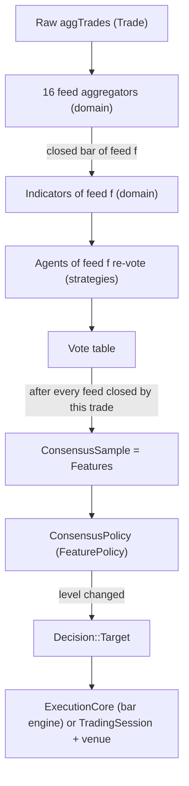

# Strategy Specification: Swarm Consensus (Multi-Agent Voting)

## 1. Objective and Provenance

This strategy ports, corrects, and extends the multi-agent Expert Advisor of the author's master's
thesis ("Multiagencia para el Trading", Universidad de Sevilla, 2026; source
`github.com/f92esmup/tfm-clips`). The original ran in MetaTrader 5 on EUR/USD, long-only, with
100 CLIPS rule-engine agents behind a C++ DLL.

The goal is **not bit-exact parity**. ATSNT keeps the idea, fixes the defects found in the
original, and adds:

- **short selling**, through mirrored rules generated from one definition;
- **all 16 bar feeds** (time, tick, volume, range), calibrated for BTCUSDT;
- a **target-position execution model**: scale-in, scale-out, flip, and exit by consensus, with no
  take profit and no time barrier.

The whole port is 100% Rust: no FFI, no rule-engine runtime, no strings between layers.

Scope of this specification: backtest (bar and tick fill models) and HPO. The strategy runs on the
repository's **single** execution model, generalised so that triple-barrier entries and target
positions share one engine, one venue contract, one registry, and one optimiser (Section 3).
Paper and live trading refuse it through a product gate until results justify lifting it
(Section 17).

The idea in one paragraph: the market is the result of many independent participants, so the
strategy models it with many independent agents. Each agent watches one bar feed. It reads
the market through its own randomly sampled thresholds (its *genome*) and votes. No agent decides
alone. The net vote of the swarm moves a discrete exposure level with hysteresis, and the engine
holds the position that level asks for.

---

## 2. Glossary

| Term | Meaning |
| :--- | :--- |
| Feed | One bar stream built from raw trades (for example "time bars of 1h"). There are 16. |
| Closed bar | A bar that has finished. Agents only ever see closed bars. |
| Genome | The 11 thresholds of one agent, sampled once at construction. |
| Agent | A genome plus a feed id. It is stateless; its vote is a pure function of its inputs. |
| Macro state | Discrete reading of the four indicators (direction, momentum, volatility, liquidity). |
| Micro set | The set of candle patterns found on the agent's feed (pin bar, engulfing, inside bar, break of structure). |
| Rule | A condition over the macro state and micro set that produces one action. |
| Action | One of `LongEntry`, `LongExit`, `ShortEntry`, `ShortExit`. |
| Vote | Per agent, a pair `(long_vote, short_vote)`, each in `{-1, 0, +1}`. |
| Net vote | Per axis, the sum of the agents' votes divided by the number of agents (range -1 to +1). |
| Level | Signed exposure step `k ∈ {-3,…,+3}`. Positive is long, negative is short, 0 is flat. |
| Target | The level the policy asks for, with its risk fraction and stop distance. |
| Campaign | Everything from leaving flat to returning to flat (or flipping). It counts as one closed trade. |
| Decision | What any strategy returns: `Entry(OrderIntent)` (triple barrier) or `Target(TargetPosition)`. |
| Features | The output of a strategy's first, frozen stage. For the swarm, a `ConsensusSample`; for CUSUM and OFI, the dollar bar itself. |
| Price event | An OHLC bucket of trades (one trade, one dollar bar, or 1 s of trades) that the execution core fills against. |

---

## 3. Architecture: One Engine for Every Strategy

### 3.1 Principle

This strategy gets **no private copy** of any mechanism the repository already has. It adds new
pieces only where none exists: bar feeds, indicators, calibration, and target positions. Each new
piece is general-purpose, so any future strategy can use it.

The target-position model is not a second execution path. It is the **general case** of the
existing one. A triple-barrier trade is "go to ±q now; go to 0 when the stop, the take profit, or
the time limit is hit". Every runner therefore keeps exactly one of each:

| Concern | The single component | Used by |
| :--- | :--- | :--- |
| What a strategy decides | `domain::Decision` | every strategy |
| How a strategy is called | `strategies::Strategy` | engine, session, contract tests |
| How a strategy is optimised | `strategies::OptimizableStrategy` (two stages) | `run_hpo`, registry |
| How a decision becomes a quantity | `domain::RiskPolicy` (`size_order`, `size_target`, one shared core) | engine, simulated venue, session |
| How fills become position and trades | `ExecutionCore` with its `TradeLedger` | bar engine, session |
| How orders reach a venue | `ports::ExecutionVenue` + `ports::ExitGateway` | session (simulated and live venues) |
| Which strategies exist | `register_strategies!` | every runner |

**Mapping found duplication that predates this work** (Section 17.2): the monthly breaker, excursion
tracking, and equity marking each exist once in the bar engine and once in the session path.
Closed-trade accounting is also duplicated, and it is unified here, because the target model needs
partial fills on both paths, and writing them twice would create new duplication. The rest is
listed as follow-up work and left untouched, to keep the change minimal.

### 3.2 One decision type

```rust
// crates/domain
pub enum Decision {
    /// Triple-barrier entry: accepted only when flat with nothing pending.
    Entry(OrderIntent),
    /// Signed exposure level: accepted at any time; replaces a pending target.
    Target(TargetPosition),
}

pub struct ProtectiveExits {
    pub stop: Decimal,                // always present (disaster or regular stop)
    pub take_profit: Option<Decimal>, // Some for Entry, None for Target
    pub max_bars: Option<usize>,      // Some for Entry, None for Target
}
```

Both variants become one `ExecutionPlan { target_quantity (signed), exits: ProtectiveExits }`
through one domain planner:

- **Entry(intent)**: quantity from `size_order`, which is unchanged. Sign from `intent.side`.
  Exits are `{intent.stop_loss, Some(intent.take_profit), Some(intent.max_bars_hold)}`.
- **Target(t)**: quantity from `size_target`. Sign from `t.level`. Exits are
  `{fill ∓ t.stop_distance, None, None}`.

The two kinds are not mixed in one position. A `Target` that arrives while a triple-barrier
`Entry` position is open or pending is ignored and counted `UnsupportedDecision`; an `Entry` that
arrives while a target is open or pending is ignored, as any entry is when not flat (Section 11.2).

`size_order` and `size_target` share one private quantity core. That core keeps the operation
order of today's `size_order` (`risk.rs:254-259`):

1. `(equity·risk) / stop_distance`;
2. the minimum with `(equity·max_leverage) / price`;
3. floor to the step.

So every existing sizing result stays identical.

### 3.3 One strategy contract

```rust
// crates/domain
pub enum MarketEvent<'a> { Trade(&'a Trade), DollarBar(&'a DollarBar) }
pub enum InputKind { DollarBars, Trades }

// crates/strategies
pub trait Strategy: Send {
    fn name(&self) -> &str;
    fn compatible_market_types(&self) -> &'static [MarketType];
    fn input_kind(&self) -> InputKind;
    fn on_event(&mut self, event: &MarketEvent) -> Option<Decision>;
    fn reset(&mut self);
    /// Capability used by the paper/live product gate (Section 17.1). Default: false.
    fn emits_targets(&self) -> bool { false }
    /// Strategy-specific audit written into reports as `strategy_audit`. Default: None.
    fn audit(&self) -> Option<serde_json::Value> { None }
}
```

- Runners prepare the input the strategy declares. `DollarBars` keeps today's
  `DollarBarAggregator` path, byte for byte. `Trades` passes raw trades.
- `Strategy::on_bar` stays, with a default that decides nothing. The default `on_event` sends a
  dollar bar to `on_bar` and wraps its intent in `Decision::Entry`, and ignores raw trades. The
  default `input_kind` is `DollarBars`.
- `dollar_bars_cusum`, `order_flow_imbalance`, and every existing test strategy therefore keep
  their `on_bar` code **unedited**. Only a strategy that consumes trades or emits targets
  overrides `input_kind` and `on_event`.
- Runners select behaviour by `input_kind()` and by the `Decision` variant, never by strategy name
  (`architecture_contract.rs` keeps enforcing this).

### 3.4 One optimisation contract: two stages for every strategy

```rust
pub trait FeatureExtractor: Send {
    type Features: Clone + Send + Sync + 'static;
    fn on_event(&mut self, event: &MarketEvent) -> Option<Self::Features>;
    fn reset(&mut self);
}

pub trait OptimizableStrategy: Strategy + Sync + Sized {
    type SharedConfig; // frozen for a whole HPO run (config bounds + Default); () when none
    type Config;       // searched (config bounds)
    type Space: HyperparameterSpace<Config = Self::Config>;
    type Extractor: FeatureExtractor;
    fn id() -> &'static str;
    fn from_config(shared: &Self::SharedConfig, config: Self::Config) -> Result<Self, DomainError>;
    fn extractor(shared: &Self::SharedConfig) -> Result<Self::Extractor, DomainError>;
    fn on_features(&mut self, features: &<Self::Extractor as FeatureExtractor>::Features)
        -> Option<Decision>;
    fn default_space() -> Self::Space;
}
```

The strategy **is** its own decision stage: there is no wrapper type. One instance serves both
uses:

- **Engines and sessions** call `Strategy::on_event`.
- **The HPO** builds the extractor once and calls `on_features` on fresh instances, one per
  candidate.

Concretely:

- **CUSUM and OFI**: `SharedConfig = ()`, `Extractor = BarPassThrough` (returns the bar it
  receives), and `on_features(bar) = on_bar(bar)` wrapped in `Decision::Entry`. Their HPO tape is
  the bar vector, which is exactly what `run_hpo` builds today.
- **Swarm**:
  - `SharedConfig` is the structural configuration (Section 14.1);
  - `Extractor` is `SwarmEnsemble`;
  - `on_features` runs the `ConsensusPolicy` on a `ConsensusSample`;
  - `on_event` is the extractor followed by `on_features`, so the two stages cannot drift.
- **The contract suite enforces it.** It checks that extractor + `on_features` decide exactly what
  `on_event` decides on the same synthetic input (`crates/strategies/src/contract.rs`).
- **The HPO** runs the extractor **once per run** and replays only `on_features` per candidate
  (Section 15). A future machine-learning strategy fits the same shape: a frozen model as the
  extractor, thresholds as the decision stage.

### 3.5 One execution core

`ExecutionCore` (crate `backtest`) is **extracted** from `BacktestEngine`, not written next to it:

- position state (`domain::Position`);
- the pending order and its due time;
- `ProtectiveExits`;
- margin and liquidation;
- funding;
- fill price, slippage, and fee math;
- the `TradeLedger`, which turns fills into `ClosedTrade`s.

`BacktestEngine` keeps its loop (rollovers, breakers, kill switch, mark to market, excursion) and
delegates the rest to the core, in the same order as today.

A **price event** is what the core trades against:

- with the bar fill model it is a dollar bar, as today;
- at trade resolution it is one trade;
- in HPO it is a 1 s bucket of trades.

### 3.6 One venue contract

The session path (`--fill-model tick`, paper, live) executes the same `Decision`s through the
ports. The ports gain the minimum needed:

- `ExecutionVenue::submit_order(symbol, OrderRequest { side, quantity, reduce_only }) -> EntryAck`.
  It sends a market order of an explicit quantity and does no sizing in the venue. `submit_entry`
  stays, unchanged, for `Decision::Entry`.
- `ExitGateway::place_exits(symbol, entry_side, stop_loss, take_profit: Option<Decimal>)`. With
  `None`, only the stop leg is placed.

The implementations generalise code that already exists:

- `SimulatedVenue::submit_order` generalises `submit_market_order_at` (`simulated_venue.rs:187`)
  with the existing `WorkingOrder.reduce_only`.
- The Binance gateway generalises its private `submit_futures_order` (a `MARKET` order with a
  `reduceOnly` flag) and skips the take-profit algo order when it is `None`.
- `TradingSession` sizes targets with the same domain planner and sends delta orders. After each
  fill it re-places the stop (`cancel_orders` + `place_exits(.., None)`), and it closes trades
  through the same `TradeLedger` as the core.

### 3.7 Data flow of this strategy



- **Stage A**, the extractor: expensive, frozen during HPO.
- **Stage B**, the policy: cheap, searched.

---

## 4. Market and Data

- Instrument: BTCUSDT USD-M perpetual (`MarketType::UsdMPerpetual`). Spot is not supported.
- Input: Binance futures aggTrades loaded through the existing readers (`BinanceParquetReader`,
  `BinanceCsvReader`) as `domain::Trade { timestamp, price, quantity, side }`.
- A "tick" in this document is one aggTrade. The domain has no raw trade ids, so tick bars count
  aggTrades.
- Volume is base-asset quantity (BTC). The original used MT5 tick volume because forex has no real
  volume.
- All prices, quantities, indicator values, thresholds, and balances are `rust_decimal::Decimal`.
  No `f32`/`f64` exists anywhere in this strategy, including genome sampling (Section 7.2).

---

## 5. The 16 Feeds

### 5.1 Feed table

Four bar types × four horizons. Feed ids are fixed and ordered:

| id | Type | Horizon | Threshold |
| :-: | :--- | :--- | :--- |
| 0 | Time | 5m | 300,000 ms |
| 1 | Time | 1h | 3,600,000 ms |
| 2 | Time | 4h | 14,400,000 ms |
| 3 | Time | 1d | 86,400,000 ms |
| 4 | Tick | ≈5m | aggTrades per bar, calibrated |
| 5 | Tick | ≈1h | calibrated |
| 6 | Tick | ≈4h | calibrated |
| 7 | Tick | ≈1d | calibrated |
| 8 | Volume | ≈5m | BTC per bar, calibrated |
| 9 | Volume | ≈1h | calibrated |
| 10 | Volume | ≈4h | calibrated |
| 11 | Volume | ≈1d | calibrated |
| 12 | Range | ≈5m | relative range `(high - low) / open`, calibrated |
| 13 | Range | ≈1h | calibrated |
| 14 | Range | ≈4h | calibrated |
| 15 | Range | ≈1d | calibrated |

### 5.2 Bar contents

Every feed emits a `FeedBar`:

- `start_time` and `end_time` (inclusive, ms);
- `open`, `high`, `low`, `close`;
- `volume` (sum of base quantity);
- `trade_count`.

### 5.3 Aggregation rules

**Time bars** (corrects the drift in the original, which started a bar at the tick that closed the
previous one):

- Bars are aligned to UTC epoch multiples of the horizon. Bucket `b` covers
  `[b·Δ, (b+1)·Δ)`.
- A trade belongs to the bucket that contains its timestamp.
- The bar of bucket `b` is emitted when the first trade with `timestamp ≥ (b+1)·Δ` arrives. That
  trade **does not belong** to the emitted bar; it opens the next one. This is the only way a
  trade-driven replay learns that a clock interval ended, and it cannot leak future data into the
  closed bar.
- Empty buckets emit no bar. On BTCUSDT a 5m bucket without trades is practically impossible, and
  inventing a flat bar would distort RSI and ATR.

**Tick, volume, and range bars**:

- The trade that reaches the threshold **belongs** to the bar it closes, as in the existing
  `DollarBarAggregator`. The next trade opens a new bar.
- Tick: close when `trade_count ≥ threshold`.
- Volume: close when `volume ≥ threshold`. Excess volume is **not** carried into the next bar.
  The existing dollar aggregator's carry-over double counts volume across bars, and that pattern
  is deliberately not copied.
- Range: close when `(high - low) / open ≥ threshold`. A single trade that jumps far past the
  threshold still closes the bar on that trade; the bar keeps its true high and low.

A partial bar at the end of the data is never emitted.

### 5.4 Calibration of tick, volume, and range thresholds

The original used fixed EUR/USD numbers (ticks 100/1500/6000/24000, volume 500/5000/20000/80000,
range 50/200/500/1500 points). They mean nothing on BTCUSDT. ATSNT calibrates every threshold
so that the feed's **mean bar duration equals its time counterpart** (5m, 1h, 4h, 1d). This
makes the four bar types comparable horizons instead of arbitrary numbers.

Over a calibration period with `N` aggTrades, total volume `V`, and duration `T` ms, for a target
duration `Δ`:

- tick threshold `= ceil(N · Δ / T)`;
- volume threshold `= V · Δ / T`, rounded to 3 decimals;
- range threshold: the value `r` for which a range-bar pass over the calibration period yields
  `round(T / Δ)` bars. Bar count decreases monotonically in `r`, so `r` is found by bisection on
  `[0.00001, 0.5]` until the count is within 1% of the target, or after 60 iterations. It is
  rounded to 6 decimals.

**No look-ahead**: the calibration period must end **strictly before** the first trade of any data
the strategy is evaluated on. The run refuses a configuration whose calibration end is not
earlier than its data start (Section 15.2). Thresholds are part of the frozen structural
configuration and are written into the artifact.

### 5.5 Rolling window

Each feed keeps the last `history_size = 50` closed bars in a fixed-capacity ring buffer. Index 0
is the most recent closed bar, index 1 the one before it, and so on. The bar in formation is never
visible to indicators or agents.

---

## 6. Indicators (per feed)

Indicators are computed once per feed (16 feeds × 5 values), not per agent, and updated **only
when that feed closes a bar**. All are incremental where the math allows it.

Notation: `C_t`, `H_t`, `L_t` are the close, high, and low of the bar that just closed; `C_{t-1}`
is the previous close.

### 6.1 RSI (Wilder, period 14)

- Change `d_t = C_t - C_{t-1}`. Gain `g_t = max(d_t, 0)`. Loss `l_t = max(-d_t, 0)`.
- Seed: after the first 14 changes, `G = mean(g)` and `L = mean(l)` (simple mean).
- Then `G = (G·13 + g_t) / 14` and `L = (L·13 + l_t) / 14`.
- `RSI = 100` if `L = 0`, otherwise `RSI = 100 - 100 / (1 + G/L)`.
- Ready after 15 closed bars. Range: 0 to 100.

### 6.2 ATR (Wilder, period 14) and ATR ratio

- `TR_t = max(H_t - L_t, |H_t - C_{t-1}|, |L_t - C_{t-1}|)`.
- Seed: the simple mean of the first 14 TRs. The original seeded with a single TR, which biased
  early values; that is fixed here.
- Then `ATR = (ATR·13 + TR_t) / 14`.
- `ATR` is ready after 15 closed bars. It is expressed in price units and used for normalisation
  and for the stop.
- **ATR ratio** (the volatility dimension): `atr_ratio_t = ATR_t / mean(ATR over the last 50 ATR
  values)`. It is adimensional: 1.0 means "typical volatility for this feed". It is ready after
  64 closed bars (15 + 49).

The original compared raw ATR against a per-feed table `base_atr[16]` of EUR/USD constants, and a
`%.2f` formatting bug turned those thresholds into `0.00` (Section 13, C1). The ratio replaces both.

### 6.3 ALMA slope (period 9, offset 0.85, sigma 6)

- `m = 0.85 · (9 - 1) = 6.8` and `s = 9 / 6 = 1.5`.
- Weights `w_i = exp(-(i - m)² / (2 s²))` for `i = 0..8`, where `i = 0` is the **oldest** of the
  last 9 closes and `i = 8` the most recent. They are computed once in `Decimal`, through
  `MathematicalOps::exp`.
- `ALMA_t = Σ w_i · C_i / Σ w_i`.
- **Normalised slope** (the direction dimension): `alma_slope_t = (ALMA_t - ALMA_{t-1}) / ATR_t`,
  in ATR units per bar.
- Ready when both ALMA values and ATR exist (from closed bar 15 on).

The original compared the raw slope against `base_alma[16]` constants (price units per feed).
Normalising by ATR makes one genome prior valid for every feed and every asset.

### 6.4 VWAP deviation (window 50)

- Typical price `P_i = (H_i + L_i + C_i) / 3`.
- `VWAP = Σ P_i · volume_i / Σ volume_i` over the last 50 closed bars. It is undefined if the
  volume sum is 0.
- **Deviation** (the liquidity dimension): `vwap_dev_t = |C_t - VWAP| / ATR_t`, in ATR units.
- Ready after 50 closed bars (and ATR ready).

The original used a percentage with one constant prior (0.15%) for every feed. A 0.15% move is 3
ATR on M5 and 0.2 ATR on D1, so the prior meant different things on every feed. ATR units fix that.

### 6.5 Feed readiness

A feed is **warm** when every value above is ready: 64 closed bars, set by the ATR ratio. Agents of
a cold feed vote `(0, 0)`.

---

## 7. The Genome

### 7.1 Parameters and priors

Each agent samples 11 thresholds once, in this fixed order:

| # | Gene | Unit | Prior (mean, std) | Clamp | Original (TFM) |
| :-: | :--- | :--- | :--- | :--- | :--- |
| 1 | `rsi_overbought` | RSI points | N(70, 3.5) | [50, 85] | N(70, 3.5), max 85 |
| 2 | `rsi_oversold` | RSI points | N(30, 3.5) | [15, 50] | N(30, 3.5), min 15 |
| 3 | `atr_expansion` | ATR ratio | N(1.0, 0.2) | [0.5, 3.0] | base_atr·N(1, 0.2), price units |
| 4 | `atr_contraction` | ATR ratio | N(0.5, 0.1) | [0.1, `atr_expansion` − 0.05] | base_atr·N(0.5, 0.1), price units |
| 5 | `vwap_deviation` | ATR units | N(1.0, 0.33) | [0.1, 5.0] | N(0.15%, 0.05%) |
| 6 | `alma_slope` | ATR units per bar | N(0.07, 0.014) | [0.005, 1.0] | base_alma·N(1, 0.2), price units |
| 7 | `pinbar_long_ratio` | body multiples | N(2.8, 0.4) | [1.5, 10] | same, min 1.5 |
| 8 | `pinbar_short_ratio` | body multiples | N(0.3, 0.05) | [0.1, 1.0] | same, min 0.1 |
| 9 | `engulfing_ratio` | body multiples | N(1.15, 0.05) | [1.01, 3.0] | same, min 1.01 |
| 10 | `bos_margin` | ATR units | N(0.0, 0.07) | [−0.5, 0.5] | N(0, 0.0001), price units |
| 11 | `insidebar_ratio` | range fraction | N(0.7, 0.08) | [0.1, 1.0] | same, no clamp |

How the converted priors were derived (assumption, revisable):

- `alma_slope`: the original ratio `base_alma / base_atr` per feed was 0.04, 0.067, 0.083, and 0.1.
  Their centre, about 0.07 ATR per bar, keeps the same demand for trend strength; the standard
  deviation keeps the original 20% coefficient of variation.
- `vwap_deviation`: 0.15% was about 1 ATR on the H1 feed the thesis was tuned on. The standard
  deviation keeps the original one-third coefficient of variation.
- `bos_margin`: 0.0001 was about 0.07 ATR on H1.
- New clamps (rows 1 lower bound, 2 upper bound, 3, 4, 5, 6, 11) close gaps where the original
  could sample impossible values: a negative VWAP threshold, contraction above expansion, or an
  inside-bar ratio above 1.

Clamping puts a small probability mass at the bounds. That is accepted and audited (Section 16).

### 7.2 Deterministic sampling without floats

- RNG: `rand::rngs::StdRng::seed_from_u64(genome_seed)`, with `genome_seed = 123456` by default (the
  thesis seed). One RNG serves the whole swarm. Agents are sampled in id order and genes in table
  order, so a seed fully determines the swarm.
- Uniforms: `u = (next_u32() as Decimal + 1) / 2^32`, giving `u ∈ (0, 1]` (never 0, so `ln` is
  defined).
- Standard normal through Box–Muller in `Decimal`:
  `z = sqrt(-2·ln(u1)) · cos(2π·u2)`, using `MathematicalOps` (`ln`, `sqrt`, `cos`).
  Each normal consumes two uniforms; the sine branch is discarded, as in the original.
- Gene `= mean + std·z`, rounded to 8 decimal places, then clamped.
- The original `MathRand` stream is not reproducible outside MQL5, so the agents differ from the
  thesis while following the same distributions.

### 7.3 Agent-to-feed assignment

- `agents_per_feed = 6` (configurable, ≥ 1), so `N = 16 · agents_per_feed = 96` agents.
- Agent `i` subscribes to feed `i / agents_per_feed` (integer division): agents 0–5 watch feed 0,
  agents 6–11 feed 1, and so on.
- The original used `i % 16` with 100 agents, which gave feeds 0–3 seven agents and the rest six:
  a 17% extra weight on four feeds that nobody chose. Stratified assignment removes it.

---

## 8. The Agent

An agent's vote is a pure function:

```text
vote(genome, indicators_of_feed, last_50_closed_bars_of_feed) -> (long_vote, short_vote)
```

It is evaluated in three stages, which replace the CLIPS `focus MACRO MICRO DECISION`.

### 8.1 Macro stage: the market regime

Each dimension produces at most one state. Comparisons are strict, as in the original.

| Dimension | State | Condition |
| :--- | :--- | :--- |
| direction | `Bullish` | `alma_slope > alma_slope_gene` |
| direction | `Bearish` | `alma_slope < -alma_slope_gene` |
| momentum | `Overbought` | `RSI > rsi_overbought` |
| momentum | `Oversold` | `RSI < rsi_oversold` |
| volatility | `High` | `atr_ratio > atr_expansion` |
| volatility | `Low` | `atr_ratio < atr_contraction` |
| liquidity | `Stretched` | `vwap_dev > vwap_deviation` |

`atr_contraction < atr_expansion` is guaranteed by the clamp, so `High` and `Low` never coexist.
`Stretched` has no direction because the deviation is an absolute value.

### 8.2 Micro stage: price topology

Bar 0 is the last closed bar, and bar 1 the one before it. `body0 = |C0 - O0|`. Every detector
runs; none short-circuits another. The result is a **set** of `(pattern, direction)`.

| Pattern | Direction | Condition |
| :--- | :--- | :--- |
| Pin bar | Up | `C0 ≥ O0`, `H0 > L0`, lower wick `O0 - L0 > 0`, `O0 - L0 ≥ pinbar_long_ratio · body0`, `H0 - C0 ≤ pinbar_short_ratio · body0` |
| Pin bar | Down | `C0 ≤ O0`, `H0 > L0`, upper wick `H0 - O0 > 0`, `H0 - O0 ≥ pinbar_long_ratio · body0`, `C0 - L0 ≤ pinbar_short_ratio · body0` |
| Engulfing | Up | `C0 > O0`, `C1 < O1`, `O0 ≤ C1`, `C0 ≥ O1`, `(C0 - O0) > engulfing_ratio · (O1 - C1)` |
| Engulfing | Down | `C0 < O0`, `C1 > O1`, `O0 ≥ C1`, `C0 ≤ O1`, `(O0 - C0) > engulfing_ratio · (C1 - O1)` |
| Inside bar | Neutral | `H0 < H1`, `L0 > L1`, `(H0 - L0) ≤ insidebar_ratio · (H1 - L1)` |
| Break of structure | Up | at least one earlier bar, and every bar `j ∈ 1..len-1` has `H_j < C0 - bos_margin · ATR` |
| Break of structure | Down | at least one earlier bar, and every bar `j ∈ 1..len-1` has `L_j > C0 + bos_margin · ATR` |

Notes on fidelity:

- The pin-bar-up detector adds `H0 > L0` and a strictly positive lower wick (correction C10). In
  the original, a flat bar (`O = H = L = C`) satisfied the bullish pin bar: zero body makes both
  wick inequalities trivially true. Flat bars are common on small tick bars.
- The pin-bar-down detector is the exact mirror of the up detector (user decision, 2026-10-20). The original required `C0 < O0`, so a gravestone doji (`O = C = L < H`) was never a bearish pin bar, while its mirror, the dragonfly doji, was a bullish one. That asymmetry broke the reflection invariant of §8.4.
- The break of structure compares against every bar in the 50-bar window, as the CLIPS
  `(not (vela ...))` pattern did. The margin is now in ATR units (correction C5).
- An empty micro set is **noise**.

### 8.3 Decision stage: the rule table

The rules come from `03_decision.clp`. Each original rule acts on the long axis. Its mirror acts on
the short axis and is **generated**, not hand-written, by this transformation:

- `Bullish ↔ Bearish`;
- `Overbought ↔ Oversold`;
- pattern direction `Up ↔ Down`;
- `High`, `Low`, `Stretched`, and `Neutral` stay as they are;
- `LongEntry → ShortEntry` and `LongExit → ShortExit`.

Long-axis rules (the original, with names kept for traceability):

| Id | CLIPS rule | Condition | Action |
| :--- | :--- | :--- | :--- |
| E1 | `decision-comprar-continuacion-alcista` | `Bullish ∧ High ∧ (PinBar↑ ∨ Engulfing↑)` | `LongEntry` |
| E2 | `decision-comprar-ruptura-estructural` | `Bullish ∧ BoS↑` | `LongEntry` |
| E3 | `decision-comprar-rebote-sobrevendido` | `Oversold ∧ Stretched ∧ (PinBar↑ ∨ Engulfing↑)` | `LongEntry` |
| E4 | `decision-comprar-acumulacion` | `Bullish ∧ Low ∧ InsideBar` | `LongEntry` |
| E5 | `decision-comprar-fuerza-bruta` | `Bullish ∧ High ∧ ¬Overbought ∧ (BoS↑ ∨ Engulfing↑)` | `LongEntry` |
| X1 | `decision-reducir-agotamiento-alcista` | `Overbought ∧ (PinBar↓ ∨ BoS↓)` | `LongExit` |
| X2 | `decision-reducir-falta-liquidez` | `Stretched ∧ InsideBar` | `LongExit` |
| X3 | `decision-reducir-cambio-tendencia` | `Bearish` | `LongExit` |
| X4 | `decision-reducir-freno-volatilidad` | `Low ∧ Overbought` | `LongExit` |

Short-axis mirrors, generated:

| Id | Condition | Action |
| :--- | :--- | :--- |
| E1′ | `Bearish ∧ High ∧ (PinBar↓ ∨ Engulfing↓)` | `ShortEntry` |
| E2′ | `Bearish ∧ BoS↓` | `ShortEntry` |
| E3′ | `Overbought ∧ Stretched ∧ (PinBar↓ ∨ Engulfing↓)` | `ShortEntry` |
| E4′ | `Bearish ∧ Low ∧ InsideBar` | `ShortEntry` |
| E5′ | `Bearish ∧ High ∧ ¬Oversold ∧ (BoS↓ ∨ Engulfing↓)` | `ShortEntry` |
| X1′ | `Oversold ∧ (PinBar↑ ∨ BoS↑)` | `ShortExit` |
| X2′ | `Stretched ∧ InsideBar` | `ShortExit` |
| X3′ | `Bullish` | `ShortExit` |
| X4′ | `Low ∧ Oversold` | `ShortExit` |

X2 and X2′ have the same condition. "Stretched and compressed" is a direction-free reason to
reduce exposure on both sides.

The rules live in one constant table: `const LONG_RULES: &[Rule]`, plus `mirror(&Rule) -> Rule`.
Each `Rule` has an id, an action, and a condition built from a small combinator type
(`All`, `Any`, `Not`, `Macro(state)`, `Micro(pattern, direction)`). Conditions are data, not
branches, so the mirror is mechanical and testable.

### 8.4 Vote resolution (no priority bias)

The original returned the **first** `voto` fact CLIPS had asserted, so the Rete agenda order
silently decided between contradictory rules (correction C3). An `if / else if` chain has the same
defect in plain sight: the first true branch wins, and the source order becomes an undeclared
priority. ATSNT evaluates **every** rule and resolves explicitly:

1. **Cold feed**: the vote is `(0, 0)`.
2. **Noise veto**: if the micro set is empty, the vote is `(0, 0)` whatever the macro stage says.
   This follows the documented intent of `decision-esperar-por-ruido` ("el agente no opera, sin
   importar lo que digan los indicadores macro"). As a consequence, the macro-only rules X3, X4,
   X3′, and X4′ only act when some pattern exists.
3. Collect the set of fired actions `A`.
4. Long axis: `+1` if `LongEntry ∈ A` and `LongExit ∉ A`; `-1` if `LongExit ∈ A` and
   `LongEntry ∉ A`; otherwise `0`. **Both present is a conflict, which gives `0` (wait)**, as the
   user decided.
5. Short axis, the same with `ShortEntry` and `ShortExit`.
6. **Directional conflict**: if `LongEntry ∈ A` and `ShortEntry ∈ A`, both axes become 0.
7. Long-only mode (`allow_short = false`): mirrored rules are not evaluated and the short vote is
   always 0. With that, steps 3–4 reproduce the original decision module with the conflict policy
   made explicit.

Combinations that are **not** conflicts, because they agree in direction:

- `LongExit` with `ShortEntry` gives `(-1, +1)`, which is bearish.
- `LongEntry` with `ShortExit` gives `(+1, -1)`, which is bullish.
- `LongExit` with `ShortExit` gives `(-1, -1)`, which means "get flat".

Every evaluation records whether a conflict happened (step 4, 5, or 6) for the audit.

Invariants (each is a test):

- Permuting `LONG_RULES` never changes any vote.
- **Mirror symmetry**: reflecting the inputs swaps and negates the axes. Reflecting means
  `RSI → 100 - RSI`, `alma_slope → -alma_slope`, `atr_ratio` and `vwap_dev` unchanged, and candles
  reflected `p → 2M - p` with high and low swapped.
  So `vote(reflect(x)) = (short_vote(x), long_vote(x))`.

---

## 9. The Ensemble (Stage A)

### 9.1 Event handling

For every trade, in timestamp order:

1. Feed every aggregator (feed ids 0 to 15, in order) with the trade. Collect the feeds that
   closed a bar.
2. For every closed feed, update its ring buffer and indicators, then re-evaluate **only** the
   agents subscribed to it. Store each new vote in the vote table.
3. If at least one feed closed on this trade **and** the swarm is ready, emit one
   `ConsensusSample` stamped with the trade's timestamp.

Votes **persist**: an agent keeps its last vote until its feed closes another bar, so a 1d agent
votes with yesterday's bar all day. This is the original behaviour, and it is intended: slow
feeds give slow context.

Several feeds can close on the same trade, for example every time feed at midnight. All of them
update before the single sample, so the sample never shows a half-updated swarm. That matches the
original "consensus only when the queue is empty". The MT5 queue, its three-agents-per-tick limit,
and its drop-on-full behaviour were platform workarounds and are not reproduced (correction C9).

### 9.2 Readiness

The swarm is **ready** when all 16 feeds are warm. Before that, no sample is emitted. The original
only checked the fastest feed (M5), so agents of slow feeds took part as permanent abstainers
while the thresholds still counted 100 voters (correction C8). With 64 bars needed on the 1d
feeds, readiness takes about 64 days of data. Section 15.2 covers how runs provide it.

### 9.3 ConsensusSample

`SwarmEnsemble` implements `FeatureExtractor<Features = ConsensusSample>` (Section 3.4). It accepts
only `MarketEvent::Trade`; any other event is ignored.

```text
ConsensusSample {
  timestamp: i64,              // the trade that closed the feed(s)
  agents: u32,                 // N
  long_votes:  (up: u32, down: u32),
  short_votes: (up: u32, down: u32),
  waits: u32,                  // agents with vote (0, 0)
  conflicts: u32,              // agents whose last evaluation had a conflict
  atr_stop_reference: Decimal, // ATR (price units) of feed 1 (time 1h)
  price: Decimal,              // the trade price, for audit only
}
```

From it: `long_net = (long_up - long_down) / N` and `short_net = (short_up - short_down) / N`, both
in [-1, 1].

---

## 10. The Consensus Policy (Stage B)

### 10.1 Thresholds

Configured as fractions of `N` (the original used absolute votes out of 100; fractions keep the
meaning when `agents_per_feed` changes):

- `L1 = threshold_base`;
- `L2 = threshold_base + threshold_step`;
- `L3 = threshold_base + 2·threshold_step`;
- hysteresis `H`.

Validation: `0 < threshold_base`, `0 < threshold_step`, `L3 ≤ 1`, and `0 ≤ H`. `H > L1` is allowed,
as in the original: a level-1 position then survives until the net vote turns clearly against it.

### 10.2 One axis: the original level machine

`axis_update(current ∈ {0,1,2,3}, net) -> {0,1,2,3}`, reproduced from `CRiskManager::GetTradeParams`:

```text
t = current
if net >= L3                 { t = 3 }
else if net >= L2 && t < 2   { t = 2 }
else if net >= L1 && t < 1   { t = 1 }
if t == 3 && net < L3 - H    { t = 2 }
if t == 2 && net < L2 - H    { t = 1 }
if t == 1 && net < L1 - H    { t = 0 }
return t
```

Moving up is immediate, and a jump from 0 to 3 is allowed. Moving down needs `H` extra votes
against, and may cascade over several levels in one update. This asymmetry limits overtrading.

### 10.3 Two axes and the signed target

- `long_level = axis_update(long_level, long_net)`.
- `short_level = axis_update(short_level, short_net)` if `allow_short`, otherwise 0.
- Target level `k`:
  - if `long_level > 0` and `short_level > 0`, then `k = 0` (the swarm contradicts itself: stand
    aside, consistent with "conflict means wait");
  - otherwise `k = long_level - short_level`.

Both axes keep their own state across samples, including during a conflict.

### 10.4 Risk per level

`risk_fraction(|k|) = base_risk + (|k| - 1) · risk_increment` for `|k| ≥ 1`, and `0` for `k = 0`.
This is the original rule. With the thesis-selected 1% and 2%, level 3 risks 5% of equity, so the
search space bounds keep the user's account policy in mind (Section 14.2).

### 10.5 Protective exits: Stop loss, Take Profit, and Temporal Decay

- **Stop distance**: `stop_distance = stop_atr_multiplier · atr_stop_reference`. In HPO, `stop_atr_multiplier` is searched in `[1.5, 2.0, 2.5, 3.0, 4.0]` (anchored on feed 1 H1 ATR).
- **Take-Profit (TP)**: `take_profit_distance = take_profit_atr_multiplier · atr_stop_reference` (optional). When configured (e.g. `[None, 2.0, 3.0, 4.0, 5.0]`), the engine arms a protective take-profit barrier on the winning side (`fill + tp` for long, `fill - tp` for short).
- **Anti-whipsaw protection (`rearm_blocked`)**: When a target position exits on `TakeProfit` (or `StopLoss`), the execution core blocks re-entering on that same side until the consensus returns to flat (`k = 0`) or flips. This prevents buying at the absolute top immediately after collecting profits while the swarm vote remains momentarily high.
- **Temporal decay (`decay_horizon_seconds`)**: If configured, once a level has been held past `decay_horizon_seconds`, the policy forces a flat target exit (`k = 0`) to prevent holding stagnant positions across market regimes.

### 10.6 Emission

The policy emits `Decision::Target(TargetPosition::with_exits(timestamp, level: k, risk_fraction, stop_distance, take_profit_distance))` **only when `k` changes**, including a return to 0. The original recomputed the target lot on every
update, so changes in balance or ATR alone triggered small rebalancing orders that paid fees for
nothing (correction C6). ATSNT sizes once per level change.

---

## 11. Execution of a Target Decision

These rules are part of the single execution model (Section 3). They are written for
`ExecutionCore`, and `TradingSession` applies the same rules through the venue ports
(Section 11.10). Nothing here changes how `Decision::Entry` is executed.

### 11.1 Price events

The core consumes **price events**: OHLC buckets of trades, with the timestamps of their first
(`start_ms`) and last (`end_ms`) trade; a dollar bar maps to its own start and end times.

| Run | Price event | Source |
| :--- | :--- | :--- |
| Backtest, `--fill-model bar` | one trade (trade resolution) for `Trades` strategies; one dollar bar for `DollarBars` strategies | the runner |
| HPO | a `price_bucket_ms` bucket (default 1,000 ms) for `Trades` strategies; one dollar bar for `DollarBars` strategies | the tape (Section 15) |
| Backtest, `--fill-model tick` | none: the `SimulatedVenue` matches orders against the tape | the venue |

### 11.2 Ordering per price event

The order is that of `BacktestEngine::process_bar` (`engine.rs:228-351`). It is unchanged and shared
by both decision kinds:

1. Day and month rollover.
2. Funding settlement.
3. Fill the pending order if it is due (`due_ms ≤ event start`).
4. Liquidation, then protective exits (stop, then take profit and time limit when present).
5. Monthly kill switch.
6. The strategy step: the strategy sees the event (trade or bar) and may return a `Decision`.
7. Mark to market, peak and drawdown, daily breaker.
8. Excursion.

A decision is **scheduled**, never filled on the event that produced it:

- `due_ms = decision timestamp + latency_ms`.
- `latency_ms` is a new optional field of `BacktestConfig`. It defaults to 0, so existing
  execution contexts keep filling at the next bar open as today. The swarm's execution context
  sets 100, the paper-session default (`paper.rs:147`).
- A newer `Target` replaces a pending `Target`.
- An `Entry` is still ignored unless the strategy is flat with nothing pending (today's rule at
  `engine.rs:302-306`).
- A `Target` that arrives while a triple-barrier `Entry` position is open or pending is ignored
  and counted `UnsupportedDecision` in `rejected_orders`: mixing decision kinds in one position is
  not supported.

### 11.3 Sizing at decision time

Both kinds are sized **when the decision is made**, as the engine does for entries today: the
reference price is the decision price, and the equity is `total_equity(decision price)`, which is
what `submit_entry` uses at `engine.rs:516`. For a `Target`:

- `q_raw = equity · risk_fraction / stop_distance`;
- the leverage cap is `equity · max_leverage / price`;
- the result is floored to `quantity_step_size`. All three steps share the core of `size_order`.
- `max_position_notional`, when set, **clips** `q_raw` instead of rejecting it, and counts a
  `position_cap_clip`.
- The signed target is `q* = sign(k) · q_raw`. The order is `Δ = q* - q_current`, evaluated when the
  order is filled, so earlier fills are taken into account.

### 11.4 Orders and fills

- All orders are market orders (taker), as in the original.
- Fill price: event open `± open · slippage_pct`, against the order side. The operation shapes are
  the engine's (`open + open·pct` on a buy, `ref - ref·pct` on a sell), so the shared code gives
  identical numbers on entries.
- Fee: `(fill_px · |q|) · taker_fee_pct`.
- Reported slippage (`slippage_paid`, informative only: the fill price already includes it, so
  cash and PnL never deduct it again) uses the entry convention. An increasing fill reports
  `open · slippage_pct` plus the adverse part of the gap from the decision price (the deciding
  event's close the target was sized at), per unit; a gap in favour does not cancel the slippage.
  A reducing fill, the close of a flip, and a flat target are market exits and report
  `open · slippage_pct` per unit, as an entry's market exit does.
- **Dust**: if `|Δ| < min_order_quantity` or `|Δ| · price < min_order_notional`, no order is sent
  and the decision is counted in `rejected_orders` under the existing `RiskError` kinds. A target of
  0 always closes the whole position, whatever its size.
- **Flip** (`q*` and `q_current` non-zero with opposite signs): two fills on the same event. The
  first is a close of `q_current`, which ends the campaign. The second opens `q*`, which starts a
  new one. Each pays its own fee and slippage.
- **Scale-in** and **scale-out** go through `domain::Position::apply_fill`. Scale-in averages the
  entry price; scale-out realises PnL on the reduced quantity. A full close uses the engine's
  existing close arithmetic, so entry-and-exit trades stay identical.
- Margin is recomputed after every fill with the engine's rule (`minimum_leverage` on the new
  notional; margin `= notional / leverage`).

### 11.5 Protective exits for targets

- `ProtectiveExits { stop, take_profit: None, max_bars: None }`. There is one stop for the whole
  position (correction C7).
- After **every** fill that leaves a position open, the stop is recomputed:
  `stop = last_fill_price ∓ stop_distance`. The `stop_distance` is the one carried by the target
  being executed.
- Sizing (11.3) and the stop use the same distance. A stop-out therefore loses about
  `risk_fraction` of the equity at decision time, plus the unrealised PnL carried from earlier
  fills, plus costs.

### 11.6 Stop and liquidation execution

These are the engine's existing exit evaluation (`engine.rs:439-501`), extracted into one pure
function with optional take profit and time limit:

- Long: if `event.low ≤ stop`, the fill is `min(event.open, stop)` minus slippage. Short: if
  `event.high ≥ stop`, the fill is `max(event.open, stop)` plus slippage. The `open` term models a
  gap through the stop.
- Liquidation comes first. It is evaluated with the existing rule (`liquidate_if_due`,
  `engine.rs:396-437`), whose stop-before-liquidation check now reads `exits.stop` instead of
  `intent.stop_loss`. The value is the same for entries.
- If an increasing target fill would leave the liquidation price between the entry and the stop,
  the order is reduced, in whole lot steps, to the largest quantity whose stop trades first, and a
  `stop_beyond_liquidation` clip is counted. The clip is applied **before** the fill: the reduced
  order is the one that fills, so no oversized position ever exists. A clip to less than one lot
  places nothing.
- Exit reason strings reuse the existing ones: `StopLoss`, `Liquidation`, `MonthlyCircuitBreaker`,
  `EndOfSimulation`. Two strings are added (Section 11.9).

### 11.7 Re-arm after a forced exit

After a stop, a liquidation, or a kill-switch flatten on side `s`, the policy still holds its
level. Without a rule, the next same-sign target would re-enter at once.

**Rule**: after a forced exit, every target with the sign of `s` is ignored, and counted, until a
target of 0 or of the opposite sign arrives (correction C12). With hysteresis, this means the net
vote has to fall below `L1 - H` on that axis first.

### 11.8 Breakers

The existing breakers apply unchanged. Only their effect on a target is defined:

- **Daily breaker** (the gate today at `engine.rs:518`): while it is tripped, a target may only
  reduce `|q|`. An increase is counted under `DAILY_HALT_REJECTION`, as an entry is today.
- **Monthly kill switch** (`engine.rs:271-289`): the existing flatten and halt.

### 11.9 Campaigns and the trade ledger

The metrics pipeline (Sortino, profit factor, DSR, minimum trades per fold) works on
`ClosedTrade`s (`metrics.rs:10`). The `TradeLedger` builds them, for both decision kinds:

- A **campaign** opens when the position leaves 0 and closes when it returns to 0 or flips. For an
  `Entry`, the campaign is exactly today's trade, with one opening and one closing fill.
- `entry_price`: VWAP of the increasing fills. `exit_price`: VWAP of the reducing fills.
- `quantity`: the peak absolute quantity.
- `pnl_gross`: the sum of realised PnL. Fees, slippage, and funding: the campaign sums.
- `return_pct`, holding time, and equity fields: today's formulas.
- New `exit_reason` strings:
  - `TargetExit`: the position returned to 0. This includes a target whose level sizes to a
    quantity of 0 (it closes the position), and a flip whose opening leg is not placed (dust,
    `OrderSizeExceeded`, unmarginable, or clipped to nothing): the position ended flat;
  - `TargetFlip`: the campaign ended in a flip whose opening leg filled on the same event.
  Both are additive to the BI string domain and are documented in
  `docs/architecture/13-bi-data-contract.md`.
- A level change inside a campaign is **not** a trade. Counting each one would multiply the trade
  count and inflate significance. The fill count and the peak level per campaign go to the
  strategy audit (Section 16), not to `ClosedTrade`, whose schema does not change.

### 11.10 The same rules on the session path

`TradingSession` (tick simulation, and later paper and live) executes a `Target` like this:

1. Size it with the same planner. Equity is the venue wallet, as for entries today.
2. Send `Δ` with `submit_order`. A reduction uses `reduce_only = true`. A flip sends the reduce-only
   close first, then the opening order once the close is filled.
3. After each fill, re-place the stop with `cancel_orders` + `place_exits(symbol, side, stop, None)`.
4. Feed every fill to the shared `TradeLedger`.

Reports carry no order id. The session attributes each fill by its phase, as it does today. A new
phase, `Adjusting { delta }`, covers an open position with an order in flight. A fill on the
position side is an increase, and a fill on the opposite side is a reduction.

---

## 12. Bias Controls

| Bias | Where it would come from | Control | Proof |
| :--- | :--- | :--- | :--- |
| Rule-order priority | `if/else` chains; CLIPS agenda order | Evaluate every rule, then resolve explicitly (8.4) | Permutation test |
| Directional asymmetry | Hand-written short rules; 5 entry vs 4 exit rules | Mirrors generated from one table (8.3) | Reflection test |
| Feed overweight | `i % 16` with 100 agents | Stratified assignment (7.3) | Count test: 6 per feed |
| Look-ahead in bars | Bar in formation visible; closing trade inside a time bar | Closed bars only; time-bar closing trade excluded (5.3, 5.5) | Aggregator tests at bucket edges |
| Look-ahead in calibration | Thresholds fitted on evaluated data | Calibration must end before data start (5.4) | Run refuses overlapping periods |
| Look-ahead in execution | Fill on the deciding trade | Fill at the first event at `≥ decision + latency` (11.2) | Engine test |
| Cold-start bias | Partial swarm voting | No sample until all feeds are warm (9.2) | Readiness test |
| Unit bias | Price-unit thresholds per asset or feed | Adimensional indicators and genes (6, 7) | Scale test: prices × 10 give identical votes |
| Selection / multiple testing | Searching 11·96 genes | Genome frozen; only 5 policy parameters searched; DSR and stability (15) | HPO scorecard |
| Trade-count inflation | Each level change as a trade | Campaigns (11.9) | Engine accounting test |
| Sampling bias | Clamps | Documented; clamp hit rates audited (16) | Audit output |

---

## 13. Corrections to the Original

| Id | Original defect (file) | Correction |
| :--- | :--- | :--- |
| C1 | `atr-expansion`/`atr-contraccion` formatted with `%.2f`, so most agents got `0.00`: volatility was almost always "High" and almost never "Low" (`Ensamble.mqh` `GetAgentFactString`) | Typed `Decimal` values, no strings; adimensional ATR ratio |
| C2 | Time bars start at the closing tick, so they drift and are not clock-aligned (`Velas.mqh` `UpdateTick`) | UTC-aligned buckets (5.3) |
| C3 | Contradictory rules resolved by `do-for-fact` order (`03_decision.clp` `obtener-voto`) | Explicit resolution; conflict gives wait (8.4) |
| C4 | `feed = i % 16` overweights feeds 0–3 (`Ensamble.mqh`) | Stratified assignment (7.3) |
| C5 | Thresholds in EUR/USD price units (`base_atr`, `base_alma`, `bos_margen`, VWAP %) | ATR-normalised (6, 7) |
| C6 | Rebalance on every update, as balance and ATR drift (`TFM_Multiagente.mq5`) | Trade only on level change (10.6) |
| C7 | One stop per ticket at each scale-in | One aggregate stop (11.5) |
| C8 | Warm-up checked only on M5 | All feeds warm (9.2) |
| C9 | Time-sliced queue, three agents per tick, drop on full | Synchronous evaluation (9.1) |
| C10 | A flat bar counts as a bullish pin bar | Positive range and positive rejection wick (8.2) |
| C11 | ATR seeded with one TR | Simple-mean seed (6.2) |
| C12 | Immediate re-entry after a stop | Re-arm rule (11.7) |
| C13 | VWAP weighted by tick volume (forex) | Real base volume (6.4) |
| C14 | `MathRand` cannot be reproduced; genes sampled in `double` | `StdRng` and Box–Muller in `Decimal` (7.2) |
| C15 | Long-only | Mirrored short axis (8.3, 10.3) |
| C16 | Absolute vote thresholds out of 100 | Fractions of `N` (10.1) |

---

## 14. Configuration

### 14.1 Structural configuration (`SharedConfig`, frozen during HPO; Stage A)

| Parameter | Type | Default | Description |
| :--- | :--- | :--- | :--- |
| `genome_seed` | `u64` | `123456` | Seed of the swarm |
| `agents_per_feed` | `u32` | `6` | `N = 16 · agents_per_feed` |
| `history_size` | `usize` | `50` | Closed bars per feed window |
| `tick_thresholds` | `[u64; 4]` | calibrated | aggTrades per bar, feeds 4–7 |
| `volume_thresholds` | `[Decimal; 4]` | calibrated | BTC per bar, feeds 8–11 |
| `range_thresholds` | `[Decimal; 4]` | calibrated | Relative range, feeds 12–15 |
| `calibration_end_ms` | `i64` | from calibration | Last timestamp used to calibrate |
| `allow_short` | `bool` | `true` | `false` reproduces the thesis's long-only axis |

Indicator periods (14, 14, 9/0.85/6, 50, and 50 for the ATR ratio) and the genome priors are
constants of the strategy, written in its source and in this document. They are not
configuration.

### 14.2 Policy configuration (`Config`, searched by HPO; Stage B)

| Parameter | Type | Default | Search grid |
| :--- | :--- | :--- | :--- |
| `threshold_base` | `Decimal` | `0.50` | 0.25, 0.30, 0.35, 0.40, 0.45, 0.50, 0.55 |
| `threshold_step` | `Decimal` | `0.05` | 0.05, 0.10, 0.15 |
| `hysteresis` | `Decimal` | `0.25` | 0.10, 0.15, 0.20, 0.25, 0.30 |
| `base_risk` | `Decimal` | `0.010` | 0.005, 0.010, 0.015, 0.020 |
| `risk_increment` | `Decimal` | `0.005` | 0.005, 0.010, 0.015, 0.020 |
| `stop_atr_multiplier` | `Decimal` | `3.0` | fixed |

These are the thesis ranges, converted to fractions: 25–55 votes in steps of 5, step 5–15,
hysteresis 10–30, and risk 0.5–2% for both risk parameters. The full grid has
`7 · 3 · 5 · 4 · 4 = 1,680` combinations. Candidates whose level-3 risk
`base_risk + 2·risk_increment` exceeds `max_level_risk = 0.05` are not generated.

`perturb_neighbors` returns the adjacent grid values of each of the five searched parameters, as
for the other strategies.

---

## 15. HPO Protocol

### 15.1 One optimiser, two stages for every strategy

`run_hpo` keeps a single path. For any strategy `S`:

1. **Build the tape once.** Read the input the strategy declares (`S::input_kind()`), run
   `S::extractor(shared)` over it, and keep:
   - the features with their timestamps;
   - the price events (Section 11.1).
2. **Evaluate the candidates.** For each candidate and fold, take a fresh `S::policy(shared,
   config)` and a fresh engine. Replay the fold's features and price events, merged by timestamp,
   then score. Candidates run in parallel (rayon), as today.

For CUSUM and OFI, the features **are** the dollar bars and the price events are the same bars.
That is today's `Vec<DollarBar>`, so their HPO results stay identical, and a golden test proves
it (ODD T1.2).

For the swarm, the extractor is the ensemble and the price events are 1 s buckets. At that
resolution, ten months of BTCUSDT is about 26M events, roughly 2 GB in memory. Rebuilding the
ensemble per candidate would repeat the same work 1,680 times.

### 15.2 Data window, warm-up, and folds

- **Data window.** Evaluation starts at the later of (first trade + 70 days) and the first feature
  the extractor emits. The 1d feeds need 64 closed bars, so the first feature arrives around day 64.
  The extractor runs over the whole data. Features and price events before the evaluation start are
  dropped, so the swarm never trades half warm. The run fails with "the data window gives the swarm
  less than 70 days of warm-up ..." when nothing is left to evaluate.
- **Calibration check.** `calibration_end_ms` must be earlier than the first trade of the data.
  The run fails otherwise.
- **Folds.** They stay index-based over the price events, with today's splitter code. For
  `Trades` strategies, `--embargo-ms` (default 86,400,000) is converted to buckets as
  `embargo_ms / price_bucket_ms`. For `DollarBars` strategies, `--embargo-bars` keeps its meaning.
- **Continuity.** The extractor state runs continuously across folds (it was built once, causally),
  so no swarm fold starts cold. CUSUM and OFI keep today's fresh-per-slice behaviour, because their
  "extractor" is the bars themselves.
- **Slice edges.** Each slice starts flat. A position still open at the end of a slice closes as
  `EndOfSimulation`.

### 15.3 Scoring

The existing scoring applies unchanged to the campaign trades:

- eligibility by minimum trades per fold;
- fitness = `max(0, mean OOS Sortino) · stability`;
- Deflated Sharpe Ratio p-value;
- the deployment scorecard.

### 15.4 Validation of finalists

Re-run the winner on two paths:

1. `backtest --strategy swarm_consensus --fill-model bar` at trade resolution. The difference
   against the HPO result measures the 1 s bucket approximation.
2. `backtest --strategy swarm_consensus --fill-model tick`. The `SimulatedVenue` walks the trade
   tape with latency, which is the repository's fidelity check before trusting any result
   (`docs/architecture/12-adding-a-strategy.md` §4). The unified venue contract (Section 3.6) is
   what makes this possible.

---

## 16. Swarm Audit

Every backtest and HPO winner report includes this audit under `strategy_audit` (from
`Strategy::audit()`, Section 3.3), mirroring the thesis
audit and extending it:

- **Vote distribution** over all agent evaluations: % long up, long down, short up, short down,
  and wait.
- **Mean absolute net vote** per axis (the thesis "consenso medio").
- **Polarisation**: % of samples where both `long_up` and `long_down` exceed 10% of `N` (and the
  same for short).
- **Activation**: % of time each level `k ∈ {-3..3}` is held.
- **Conflict rate**: % of agent evaluations that ended in a conflict, split by within-axis and
  directional.
- **Noise rate**: % of evaluations with an empty micro set.
- **Rule firing counts**: per rule id (E1…X4′).
- **Clamp hit rate**: per gene.
- **Execution counters**: dust skips, clips (position cap, liquidation), breaker-ignored targets,
  re-arm-ignored targets.

---

## 17. Out of Scope and Known Limitations

### 17.1 Scope

- **Paper and live trading.** After the unification, the execution path supports `Target`
  decisions on every venue. Running this strategy in `paper_trading` or `live_trading` is still
  refused, by a single **product gate** in the shared strategy loader. Its message is:
  `strategy '<id>' emits target-position decisions, which paper_trading and live_trading do not
  accept yet`.
  Lifting the gate is a later, separate decision, taken after walk-forward and tick-level results
  justify it. The Binance implementations of `submit_order` and of the optional take profit are
  built and unit-tested against the scripted test server, but no live run exercises them.
- **Order book.** aggTrades carry no depth. The bar engine pays the configured `slippage_pct`; the
  tick path walks the trade tape.
- **Tick size.** The backtest configuration has no tick size, so bar-engine stops are not aligned to
  the exchange tick. The error is at most 0.1 USDT on BTCUSDT.
- **Quantity granularity on small accounts.** With 500 EUR, 1% risk, and a stop of about 1,500
  USDT, one level is about 0.003 BTC against a step of 0.001 BTC. Level increments are coarse, and
  many may be counted as dust.
- **Funding.** The bar engine uses the flat configured rate. The tick path uses `FundingSchedule`.
  Both behave as today.

### 17.2 Pre-existing duplication left as follow-up

Mapping the execution code found these mechanisms implemented twice before this work. They are
**not** touched, to keep the change minimal. Unifying each is its own refactor, with its own
golden tests:

| Mechanism | Bar engine | Session path |
| :--- | :--- | :--- |
| Monthly breaker | inline `monthly_open_equity` (`engine.rs:244-289`) | `MonthlyGuard` (`monthly_guard.rs:63`); semantics differ (rollover key and comparison) |
| Excursion | inline `open_excursion` (`engine.rs:339-350`) | `ExcursionTracker` (`excursion.rs:11-66`) |
| Equity marking and peak | `total_equity` (`engine.rs:135`, `:312-330`) | `marked_equity` (`monthly_guard.rs:10`) and the venue wallet |
| Leverage check input | fill price (`engine.rs:564`) | signal price (`simulated_venue.rs:525`) |

---

## 18. Worked Example of the Level Machine

Settings: `L1 = 0.50`, `L2 = 0.55`, `L3 = 0.60`, `H = 0.25`, `allow_short = true`.

| Sample | long_net | short_net | long_level | short_level | k | Emitted |
| :-: | :-: | :-: | :-: | :-: | :-: | :--- |
| 1 | 0.20 | 0.00 | 0 | 0 | 0 | none (unchanged) |
| 2 | 0.52 | 0.00 | 1 | 0 | +1 | target +1 |
| 3 | 0.61 | 0.00 | 3 | 0 | +3 | target +3 (jump) |
| 4 | 0.40 | 0.00 | 3 | 0 | +3 | none: 0.40 is not below `L3 - H` = 0.35 |
| 5 | 0.20 | 0.10 | 0 | 0 | 0 | target 0: cascade 3→2→1→0 (0.20 < 0.35, < 0.30, < 0.25) |
| 6 | −0.10 | 0.52 | 0 | 1 | −1 | target −1 |
| 7 | 0.55 | 0.55 | 2 | 2 | 0 | target 0 (contradiction) |

Sample 4 shows the hysteresis: the long net vote fell from 0.61 to 0.40, but the level stays at 3
until it falls below 0.35. Sample 5 drops all three levels in one update.
